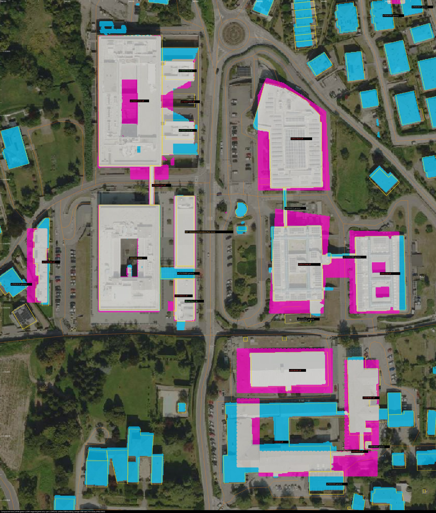
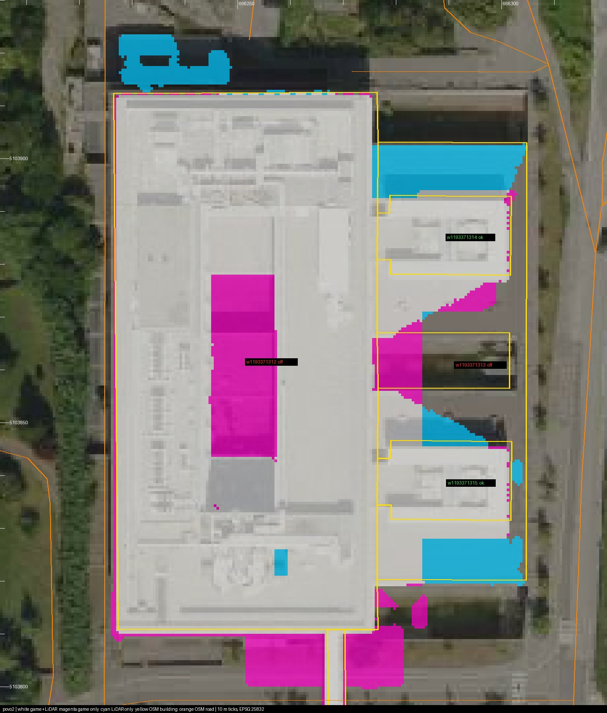
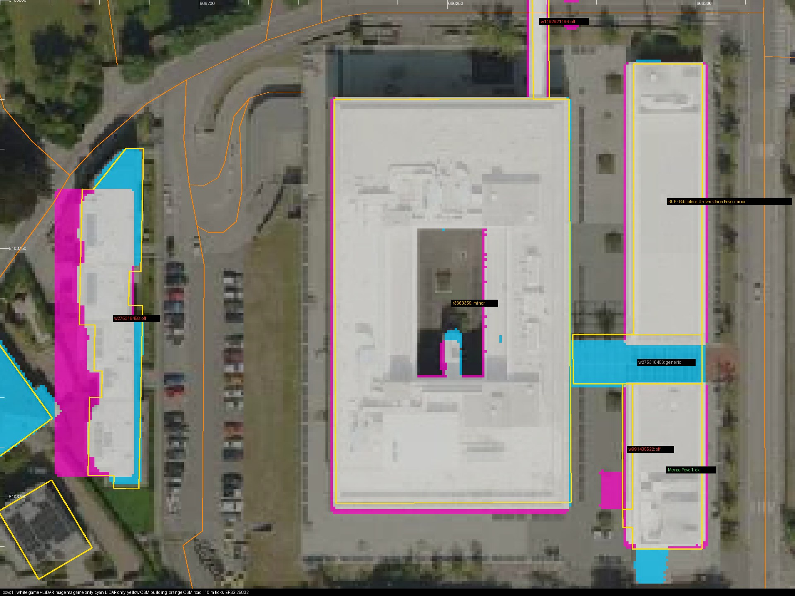
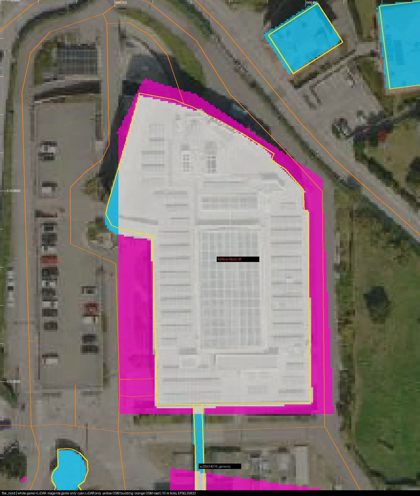
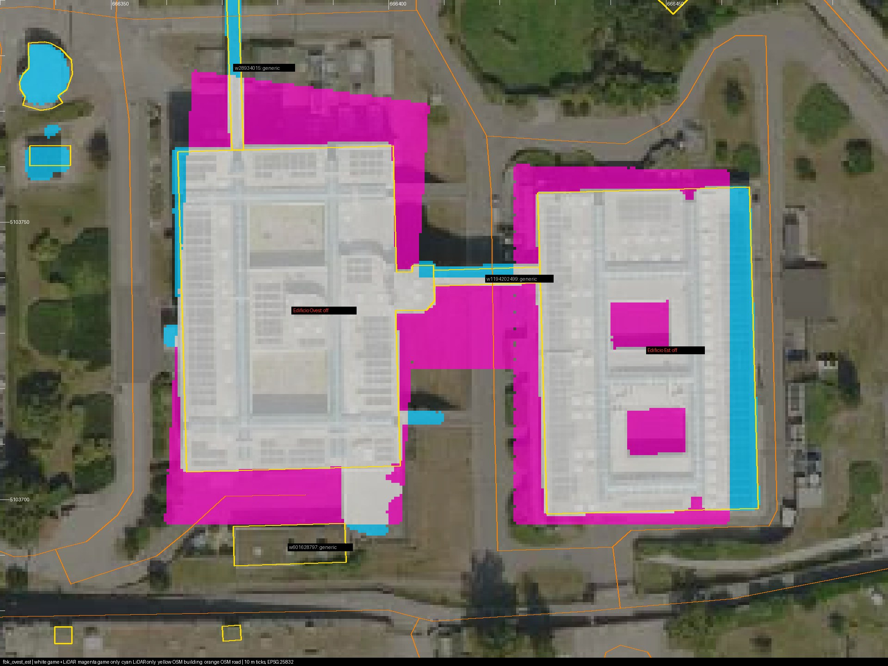
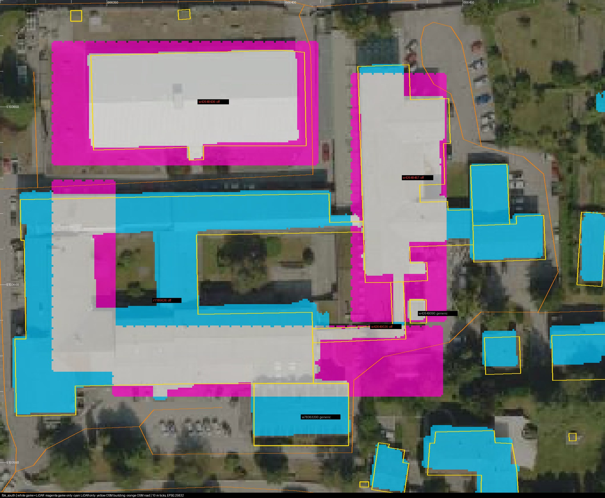
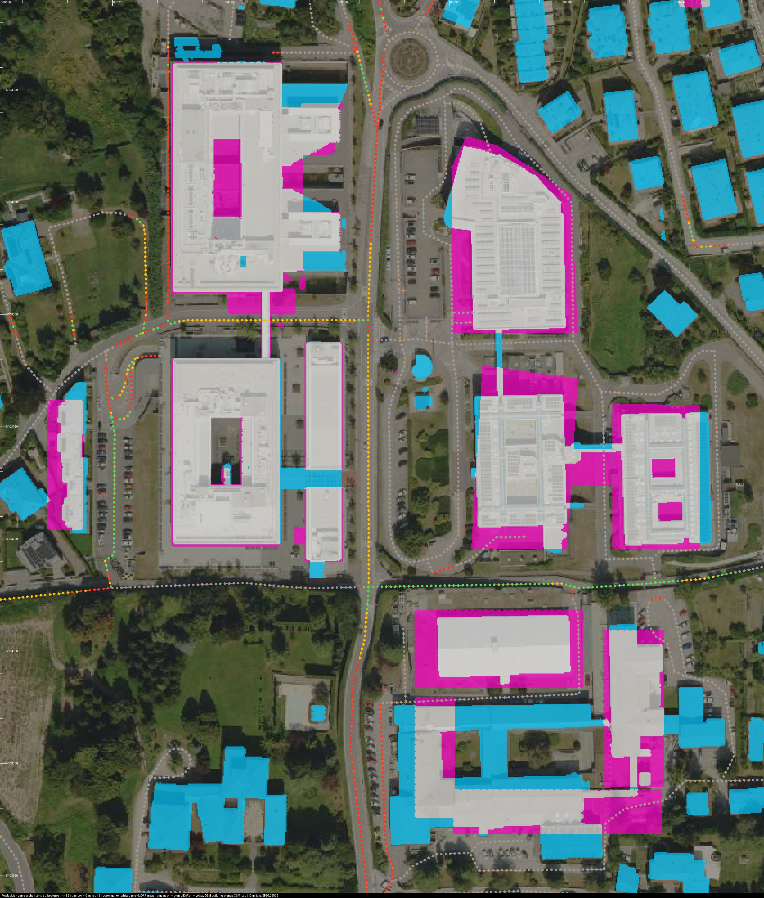

# Building and road registration against OSM and LiDAR (30 October 2026)

This audit checks every building and road in the generated campus against two
independent sources:

- **OpenStreetMap footprints and centrelines.** These come from Overture Maps
  release 2026-10-21.0, which republishes OSM with each way's ID. They are cached
  in `data/reference/osm/`.
- **PAT LiDAR.** The building mask is DBM − DTM > 2.5 m on the 0.5 m tile
  5h666051035.

The 2024 orthophoto is the visual backdrop. **No map geometry was changed.**
The results tell us what needs correcting. Corrected footprints are ready in
[`proposed_footprints.json`](../exports/building_registration_20261030/proposed_footprints.json).



In all images, white means game and LiDAR agree. Magenta is game-only mass,
cyan is LiDAR-only mass, yellow is an OSM footprint and orange is an OSM road.
Ticks are every 10 m in EPSG:25832. OSM and LiDAR each carry about 0.5–1 m of
error, so differences under 1 m count as agreement.

**About the earlier Povo 2 correction:** the OSM/LiDAR fix to Povo 2 and its
road is not in this repository's history (`main` and this branch both end at
`eea8e91`). The current Povo 2 main block still agrees with OSM and LiDAR,
with IoU 0.93 and less than 0.5 m best-fit shift. Via Sommarive beside Povo 2
does not; see *Roads*. If that correction lives elsewhere, these road numbers
predate it.

## Verdict by building

The *offset* is the mismatch area on a facade side divided by that facade's
length. It gives the average distance by which the game facade misses the OSM
one: **+** means the game is outside OSM, **−** means it falls short.

| Building (OSM) | Game source | IoU game/OSM | Mean facade offsets | Needs correction? |
| --- | --- | --- | --- | --- |
| Povo 1 (`r3663359`) | campus | 0.91 | S +1.7, W +1.0 (entrance features) | **No.** Best-fit shift is 0.5 m. |
| Povo 2 main block (`w1193371312`) | Povo 2 integration | 0.93 | S +4.0 | **Footprint no.** Verify the south strip and the courtyard (below). |
| Povo 2 annex bars (`w1193371314`, `w1193371315`) | exterior frontages | 0.98 / 0.93 | — | No. |
| Povo 2 east podium (`w1193371313`) | — | 0.34 | N −5.9, S −3.6, E −2.3 | **Verify.** LiDAR sees low roofs north and south of the annex bars that the game lacks. |
| BUP library (`w275318462`) | `povo_wings` library | 0.82 | W +2.0 | Minor. |
| Mensa (`w275318465`) | `povo_wings` canteen | 0.92 | E +1.0 | No. |
| Library–canteen link (`w275318456`) | wings | 0.68 | about 1 m south | Minor. |
| Povo bridge (`w1192921194`) | bridge | 0.41 | E +2.2, W +2.7 | **Verify.** The game's bridge mass is about 8 m wide; OSM and LiDAR show about 3.5 m. |
| Residential block west of Povo 1 (`w275318458`) | `povo_exterior.json` `residential` | 0.53 | W +4.3, E −1.4 | **Yes.** Move it about 3 m east and use the stepped OSM outline. |
| FBK Edificio Nord (`w28933741`) | `povo_edges` `fbk_north` | 0.75 | W +5.5, E +5.2, S +2.9, N +2.7 | **Yes.** About 30% too big (4,195 vs 3,178 m²). The west notch and the curved north-east facade are missing. |
| FBK Edificio Ovest (`r1185625`) | `fbk_south_west` | 0.61 | S +5.5, N +5.2, E +3.8 | **Yes.** About 60% too big (3,171 vs 1,974 m²). Its two courtyards are filled. |
| FBK Edificio Est (`r1185627`) | `fbk_south_east` | 0.64 | W +4.8, N +3.5, E −3.1 | **Yes.** About 4.5 m too far west. Two courtyards are filled. |
| FBK skybridge (`w1194202499`) | `fbk_south_link` | 0.20 | — | **Yes.** The game has a 16 m wide wing; the real link is a 3 m skybridge. |
| FBK south block (`w42648436`) | `fbk_far_south_north` | 0.62 | W +12.2, S +4.9, E +4.2 | **Yes.** |
| FBK south courtyard ring (`r1185626`) | `fbk_far_south_west`, `fbk_far_south_south` | 0.43 | W −6.6, N −3.4 | **Yes.** The south wing runs about 40 m east of the real building, a 408 m² phantom with no LiDAR return. The north wing is missing. |
| FBK south-east block (`w42648467`) | `fbk_far_south_east` | 0.69 | W +2.7, S +2.2 | Yes (minor). |
| 14 village and residential houses | generic backdrop | < 0.25 | — | No. These are generic by design and not traced one by one. |



### Povo 2 items to verify, not apply blindly

1. **South strip.** About 199 m² of roofed game volume runs along the south
   face. In the west half, the game's −1 roof is at 373.5 m. The DTM there
   ranges from 368.8 to 374.8 m: LiDAR sees an open sunken area, matching the
   −1 terrace, where the game has a roof up to 2–5 m above that real ground.
   The east half is the bridge landing. Check this against the 29 October
   terrace markup before changing it.
2. **Courtyard.** The real courtyard is open and sunken (DTM about 372.6 m).
   The game roofs it at 381.0 m. This matches the open "central void" item in
   [the layout TODO](BUILDING_LAYOUT_FIXES_TODO.md).
3. **East podium.** LiDAR sees low roofs north of the north annex bar (about
   8 m) and south of the south bar (about 6 m), and the game has neither. The
   triangular cyan wedges between the bars are DBM interpolation artefacts,
   not buildings.






## Heights and grades

Roof elevations below are LiDAR versus game, as median / 95th percentile. The
p95 includes rooftop plant.

| Building | LiDAR roof | Game roof | Comment |
| --- | --- | --- | --- |
| Povo 1 | 386.8 / 389.8 m | 384.6 m | About 2 m low. Floors use provisional 3.6 m storeys. |
| Povo 2 | 386.9 / 390.6 m | 381.0 m | About 6 m low. The game stops at the +1 roof. |
| BUP library, Mensa | 382.5 / 385 m | 380.9 m | About 1.5 m low. |
| FBK Edificio Nord | 398.0 / 400.7 m | 390.2 m | The height above ground is right (16.4 vs 15.2 m). Its grade is 9.4 m below the real terrain. |
| FBK Edificio Ovest | 393.2 / 396.5 m | 389.2 m | 15.0 m tall in reality, 11.2 m in the game. |
| FBK Edificio Est | — / 397.8 m | 388.2 m | 6.9 m tall in reality, 10.2 m in the game. Its grade is 12.9 m below the terrain. |

The edge scenery deliberately stands on flattened grades. East of Via
Sommarive the game ground is 4–13 m below the real terrain, so absolute
elevations are expected to differ. Height above ground is the comparable
figure, and it is in `report.json` as `lidar_height_m` / `game_height_m`.

## Roads



Dots sit on OSM centrelines. Green means the game asphalt centre is within
1.5 m, amber within 3 m, red more than 3 m, and grey means no game asphalt.

| Road (OSM) | Game asphalt centre vs OSM | Game minus DTM |
| --- | --- | --- |
| Via Sommarive beside Povo 1 and the library (`w97004470`) | 1.9 m west | −0.7 m |
| Via Sommarive beside Povo 2 (`w1120770362`) | **3.9 m west** | **−4.7 m** |
| Via Sommarive towards the roundabout (`w1394224846`) | **7.7 m west** | −5.8 m |
| Via Sommarive south of Via dei Valóni (`w1120615338`, `w1282493439`) | **4.1–4.6 m east** | −7.5 to −9.4 m |
| Via dei Valóni east (`w840851738`) | 0.9 m | −7.9 m (flat game road, rising real road) |
| FBK service road (`w42648702`) | **7.0 m west** | −8.1 m |
| Via alla Cascata (`w24479374`) | **4.5 m east** | −7.6 m |
| Service lane west of Povo 2 and under the bridge (`w1394224845`) | 3.6 m (median) | −4.1 m |

OSM centrelines are usually good to 1–2 m, so offsets of 3 m or more are
real.

## Recommended corrections, in priority order

1. **FBK Edificio Nord, Ovest, Est and their skybridge.** These are visible
   from the playable street. Replace the `povo_edges.json` footprints with the
   proposed OSM rings, including courtyards. Set heights from
   `lidar_height_above_ground_m`. Decide separately whether to keep the
   flattened grade.
2. **FBK south complex.** Do the same, and remove the 40 m phantom on the
   south wing.
3. **Residential backdrop west of Povo 1.** Move it about 3 m east and use the
   OSM outline.
4. **Via Sommarive from the bridge to the roundabout.** Shift it 4–8 m east.
   Review its grade along with the Povo 2 entrance levels.
5. **Confirm with the user:** the Povo 2 south −1 roof versus the sunken
   terrace, the courtyard roof, the east podium strips, and the bridge width.
6. **Heights of Povo 1, Povo 2 and the library.** This depends on the
   interior floor-stack decision; it is low priority for gameplay.

## Reproduce

```sh
python tools/fetch_osm_extract.py             # refresh the cached OSM extract (needs pyarrow)
python tools/audit_building_registration.py   # numpy + Pillow; writes exports/building_registration_20261030/
python -m unittest tests.test_building_registration
```

The audit reads `exports/povo_campus/povo1_campus.obj` and the paving OBJ, so
regenerate the campus first after any geometry change. It takes about a
minute. `report.json` holds every metric, including best-fit translations
against OSM and LiDAR, game-only mass with no OSM building, and per-road
statistics.

Sources: OpenStreetMap © OpenStreetMap contributors, ODbL 1.0, via Overture
Maps Foundation. PAT LiDAR DTM/DBM 2014–2018, CC BY 4.0. Comune di Trento
orthophoto 2024, CC0.
