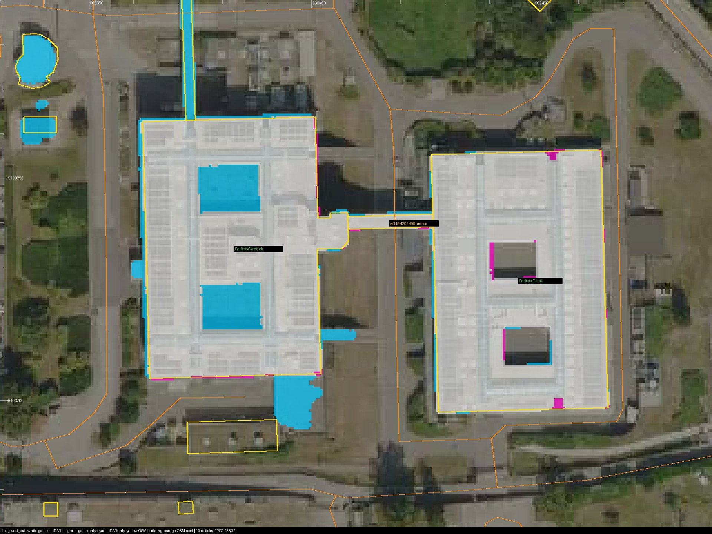

# Building registration corrections — 31 October 2026

**2 November correction:** script-only VRAD retiling described below is disabled. It produced a later corrupt atlas despite passing CRC/collision checks. Use the [lighting repair and native visual verification](RENDER_LIGHTING_CORRUPTION_20261102.md); the historical notes below are not current recovery instructions.

The [30 October audit](BUILDING_REGISTRATION_AUDIT_20261030.md) identified
oversized hand-traced scenery. The implementation uses its committed OSM
footprint proposals and LiDAR heights, retaining the shared local coordinate
origin and the existing flattened scenery grades.

## Revised scope

- Replace FBK Nord, Ovest, Est, the connecting skybridge and the south complex
  with the simplified OSM rings. Preserve all five courtyard openings in both
  the building bodies and their roofs. Combine the two former south/west
  volumes into one courtyard ring, removing the unsupported eastern extension
  and restoring its missing north wing.
- Set FBK roof heights above the retained ground to the audit's LiDAR p95
  heights, including the roof fascia. Nord's photographed rolled eave follows
  the corrected west facade. The approximately 3 m wide FBK skybridge has an
  estimated 4.5 m open underside; its roof elevation uses the LiDAR height.
- Replace the west residential block with its stepped OSM outline and LiDAR
  height. Facade panels follow the real outline rather than its bounding box.
  Move the parking's west paving edge and fence 1.2 m east to clear this facade;
  retain the parking bays and access.
- Register Via Sommarive beside Povo 2 and its approach to the roundabout against
  cached OSM centrelines. Inspection of OSM way `w24392581` also locates the
  roundabout about 35 m south of the old scenery centre: local `(82.46, 113.47)`
  rather than `(81, 149)`. Correct the roundabout and its north/east branches
  together so the road connections remain continuous. Keep the accepted road
  elevations and Povo 1 entrance transition; absolute road grading remains open.
  Cut the raised landscape out of road/footway corridors and stop the old hedge
  before the relocated roundabout, so the corrected carriageway is visible.
- The user explicitly chose to keep Povo 2's south terrace roof, courtyard roof,
  east podium and campus bridge width pending a separate photo/plan review.
  Main-building heights and interior floor stacks also remain pending. Other
  audit findings about outer roads are outside this priority correction pass.

## Implementation

`config/povo_edges.json` and `config/povo_exterior.json` retain the OSM IDs,
height evidence, grade policy and reference paths. Both generators hash the
cached extract, original proposals and shared polygon mesher in provenance.
The original audit and proposal JSON are retained as the baseline.

`tools/polygon_mesh.py` caps concave polygons using horizontal bands and even/odd
ring intersections. This leaves courtyard holes open without a GIS dependency.
Outer and courtyard facade winding is normalized before window bands and walls
are generated. FBK and the residential backdrop remain render-only scenery;
the corrected campus road and its footways retain generated collision.

The build requirements now include numpy and Pillow, already required by the
registration audit tests added in the preceding commit.

## Validation

All **351 source tests passed**. The suite covers courtyard cap area, winding and
volume, open holes in every FBK body/roof, skybridge clearance, road registration,
connected endpoints, exposed roundabout/branch surfaces and the existing source
clearance routes. An obsolete survey
test was updated to follow the already-approved C7 door and office connection
instead of assuming the basement approach remained straight.

The regenerated campus and paving OBJ surface audits both report **zero
overlapping coplanar face pairs** (652,662 and 7,854 faces respectively).
The standalone scenery audit also passes with 23,848 faces and zero overlaps.

The [new audit](../exports/building_registration_20261031/report.json) and
[before/after comparison](../exports/building_registration_20261031/comparison.json)
measure these footprint IoUs against OSM:

| Building | Before | After |
| --- | ---: | ---: |
| FBK Nord | 0.75 | 0.98 |
| FBK Ovest | 0.61 | 0.95 |
| FBK Est | 0.64 | 0.97 |
| FBK skybridge | 0.20 | 0.84 |
| FBK south north block | 0.62 | 0.96 |
| FBK south east block | 0.69 | 0.96 |
| FBK south courtyard ring | 0.43 | 0.96 |
| Residential block | 0.53 | 0.93 |

Every corrected building's worst mean facade offset is at most 0.4 m. All seven
FBK roof heights match the audit's LiDAR heights above the retained game ground.
The residential audit reads 11.6 m against 11.4 m LiDAR; its actual configured
roof top is 11.4 m above its base, with the difference coming from interpolated
surrounding game ground.

Via Sommarive's median lateral error is **3.6 → 0.1 m** beside Povo 2 and
**7.5 → 0.2 m** approaching the roundabout. The approach's p90 remains 5.8 m
where intersecting asphalt at the junction widens sampled cross sections.
Absolute grade offsets persist, as intended. These metrics do not validate
unresolved Povo 2 roofs, full interior layouts or the remaining outer roads.

Native compilation and runtime results, including the completed follow-up, are
recorded below.

The initial standard build compiled the main model in 2,056 seconds, then its
GPU lighting pass stopped making visible progress on block 1/4. Repeated GPU
counter samples showed zero activity; the job was interrupted and its automatic
retry showed the same symptoms. Initial logs are under
`build/handoff/20261031T095821634478Z/`.

The retry initially tested a numeric wrapper for Valve's hidden
`vrad3LargeBlockSize` option. Inspection of the generated script showed that
this is a boolean switch selecting 2048-pixel blocks, so the incorrect wrapper
option was removed. The successful recovery directly retiled the generated
VRAD script to 64 blocks of 256 pixels, keeping the 2048 atlas and all
`128 512 0.050` normal-quality sampling parameters unchanged. The original and
retiled scripts are saved in
`exports/building_registration_20261031/lighting-recovery/`.

The reusable recovery is now `tools/recover_povo_lighting.py --block-size 256`,
invoked from another terminal while `build_campus.cmd --fast-lighting` remains
running. It validates the target compiler/worker, pauses only that compiler,
stops the lighting child, retiles the script and resumes the compiler's normal
retry. It never overrides compiler exit status. Tests guard sampling/atlas
preservation and reject unrelated or ambiguous processes. Retry logs are under
`build/handoff/20261031T111653185782Z/`. The nine planned native walking routes
are saved in `exports/building_registration_20261031/runtime-routes.json`.

The final source suite is recorded separately in
`build/registration-source-tests-verified.log` (350 tests, passed). The retry's
initial build record still reflects the experimental option used at startup;
the saved recovered VRAD script is the authoritative lighting configuration.

### Native-test follow-up

The first package passed all 1,241 entry CRC checks, but its native walking
batch exposed the old straight east boundary fence crossing the newly aligned
Via Sommarive near local `(68, 82)`. The widened paving, both entrance banks and
parking route passed. Both frontage-ramp checks also reported a height mismatch:
the nominal centre-point grade omitted the neighbouring sloping footway under
the standing player's 0.4064 m half-width hull. These failures are retained in
`exports/building_registration_20261031/runtime-final/`.

The fence now follows the registered east kerb with its continuous collision
barrier and ends before the relocated roundabout. A source regression samples
the entire corrected street and both footway edges, including the standing hull,
against the actual barrier meshes. The replay script
`exports/building_registration_20261031/verify_runtime.py` preserves the normal
25 cm native height tolerance and derives the sloped waypoint's expected support
from the source collision surfaces beneath the hull. It also checks both
directions through each entrance bank and the parking approach.

### Final verified result

The fence-corrected **standard** build passed on 31 October. Its checked build
record is `build/handoff/20261031T121148467800Z/build.json`; durable copies of the
build record, compiler log, package check and 351-test source log are in
`exports/building_registration_20261031/`. The main model compiled in 2,105
seconds. The final lighting bake completed its four original 1024-pixel blocks
without recovery, retaining the 2048 atlas and normal quality 1. No compiler
failure occurred; existing duplicate-bone diagnostics and the unconnected-ladder
navigation diagnostic remain. This pass does not certify bot ladder traversal.

- Package: `build/package/trento_povo_campus.vpk`, **66,952,122 bytes**.
- SHA-256: `2abb571c5e33934999832d5836e7a7f4eb9fa5e2e2e375616b3bca071474570b`.
- **1,241 entries**, with every entry CRC verified.
- All **13 deployed map/model source files** match the regenerated checkout.
- The fresh solo CS2 launch used a byte-identical package copy in the test addon.
- All **12 native walking routes / 48 waypoints passed**: frontage, registered
  Via Sommarive, widened paving, both Povo 2 entrance banks and surface parking,
  each in both directions. Each route uses one initial placement, ordinary
  walking thereafter, noclip disabled and the existing 25 cm height tolerance.

The native route report, transcript, fresh-launch log and nine engine screenshots
are under `exports/building_registration_20261031/runtime-verified/`. The
[contact sheet](../exports/building_registration_20261031/runtime-verified/visual/contact-sheet.jpg)
and full-size views confirm the corrected FBK silhouettes, all five open
courtyards, the elevated skybridge, stepped residential facade, fence beside the
carriageway, exposed roundabout and connected outer road branches. Visual camera
captures use noclip and are distinct from the normal-walking evidence.

CS2 was closed after testing. Winter was not natively rebuilt, and Workshop was
not updated. These results cover this registration correction pass; absolute
road grades, final lighting/art, the deferred Povo 2 roofs/podium/bridge width and
full interior floor-stack fidelity remain outside this validation.
