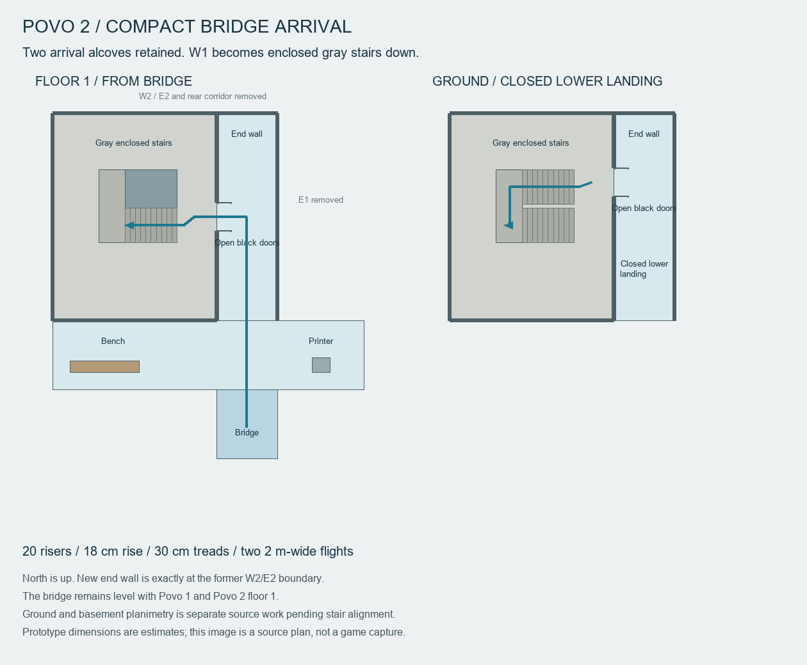
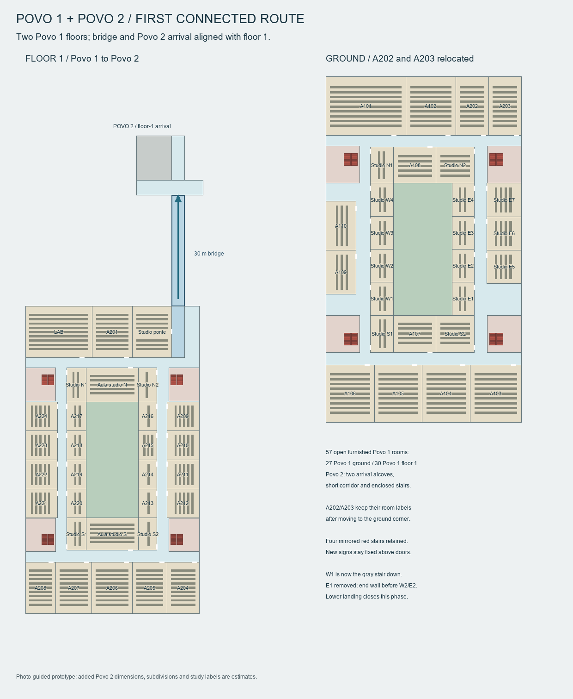
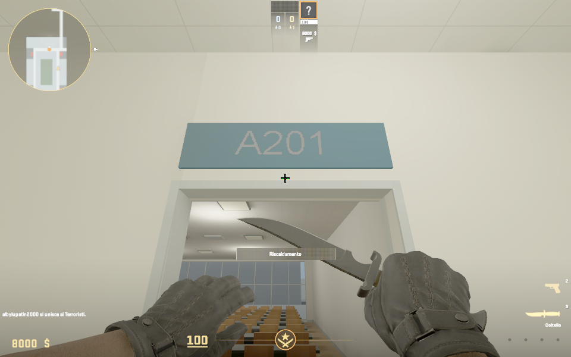
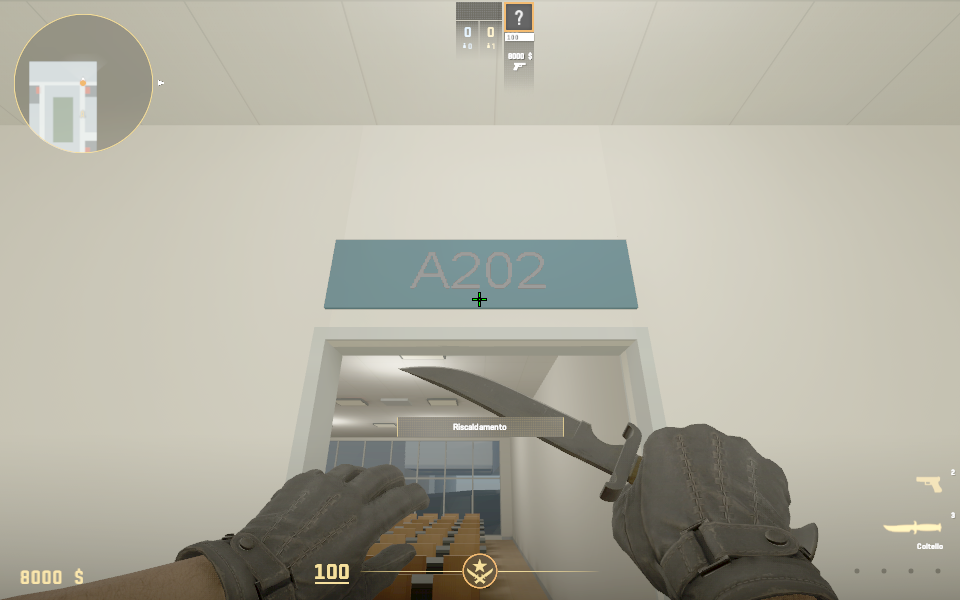
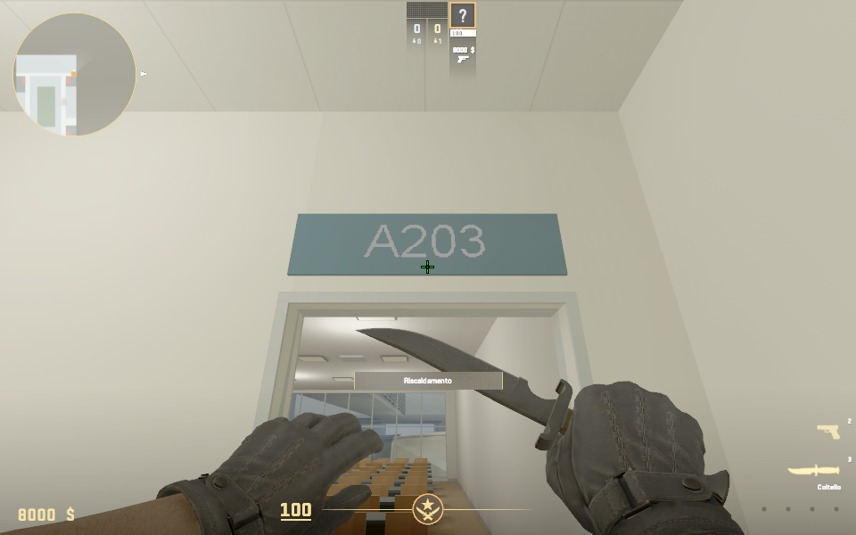
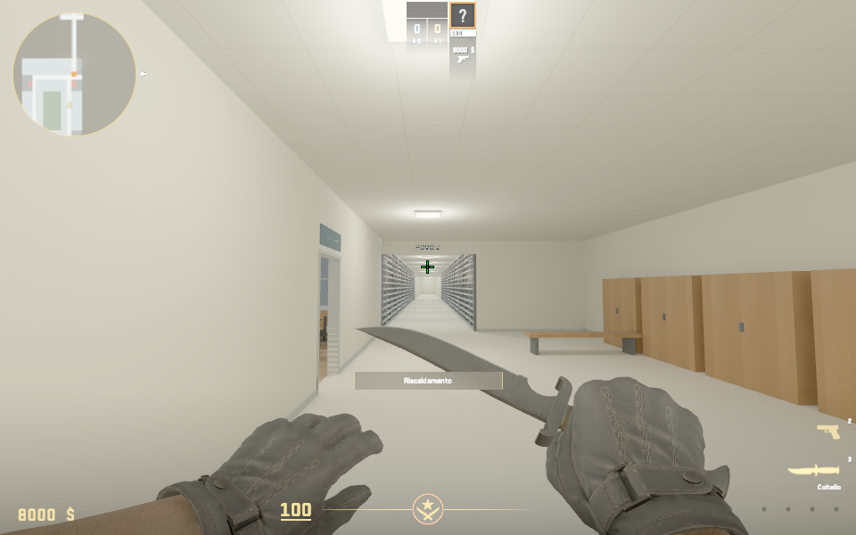
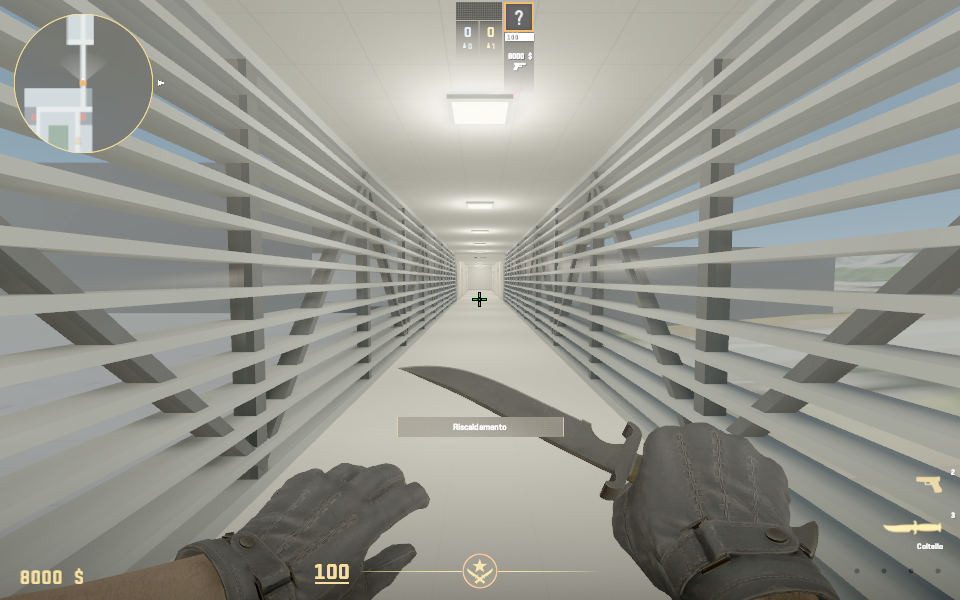
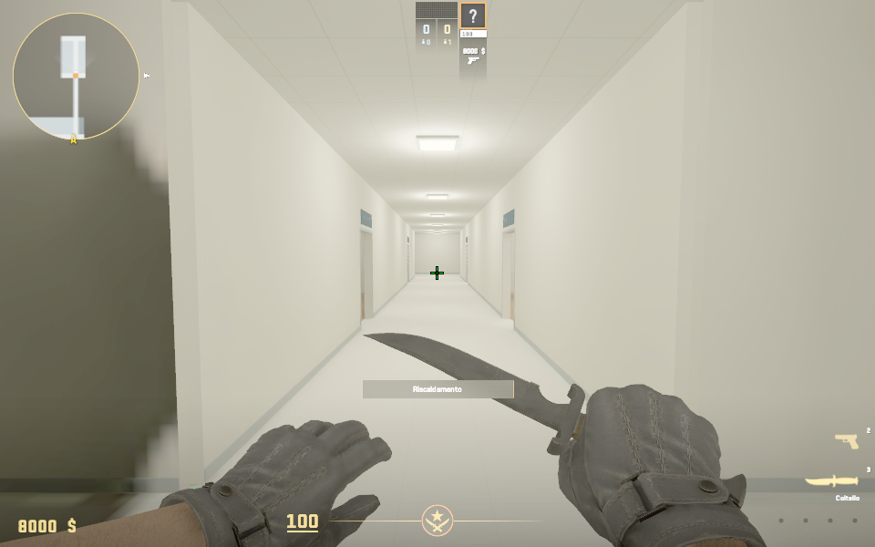
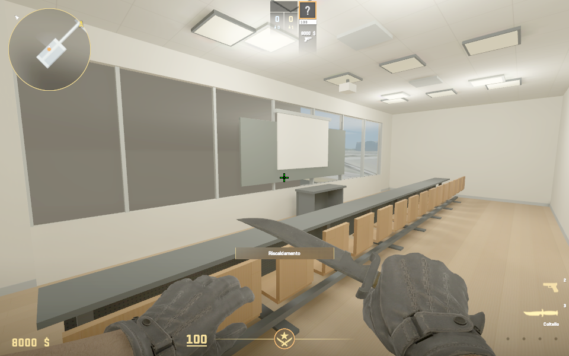

# Compact Povo 2 arrival — 23 October 2026

The latest arrival replaces the four provisional study bays. The bench alcove
on the left and printer alcove on the right of the bridge exit remain. W1 is
now an enclosed gray switchback stair, entered through open black double doors
at its former doorway. E1 is removed and its corridor wall is solid. A new end
wall closes the northbound corridor at N26, immediately before the former
W2/E2 bays; the bays and rear cross corridor have been removed.



The stairs descend from local z7.6 to z4.0 through twenty 18 cm risers, with
30 cm treads, two 2 m-wide flights and a middle landing. The upper slab is cut
around the shaft. Guards surround the upper opening, and both upper and lower
portals have open black doors with red panic bars. The lower door currently
opens into a closed vestibule. Povo 1 retains its 57 furnished rooms and all
four mirrored red stairs; no Povo 2 study-bay labels or furniture remain.

`compact_arrival` in `config/povo2_connection.json` selects this build. The
separate Povo 2 ground/basement planimetry source is preserved; the builder
defers its overlapping shell and old northern stair location until it is
aligned with the compact W1 staircase. The other Povo 2 chat is coordinating
that source work. Neither layout should be superimposed unchanged.

Source clearance passes 67 Povo 1 ground stations, 88 connected upper stations,
and four lower-stair vestibule stations. Stair checks cover all twenty tread
supports, the turns, both open portals and standing headroom. These checks use
the exported collision boxes. All 109 Python source tests pass.

### Compiled compact checkpoint

The full model/map/lighting/nav/radar build succeeded
(`build/gameplay/p2-compact-build.log`, 4,282 navigation polygons). The engine
reflection bake added one cubemap entry and preserved every original packaged
entry. Full CRC verification passed. The installed package matches the local
package exactly: 40,402,867 bytes, 162 entries, SHA-256
`cbffd1a07529e495a56e66f82aa1b85473314891779826c7ddb0914ef31bbd40`.

The CS2 walk test uses one initial placement outside the upper doorway, then
normal movement with noclip disabled. It descends both flights, turns on the
middle landing, exits the lower doorway, returns up both flights and exits
the upper doorway. All six stages reach the expected floor elevations;
evidence is `build/gameplay/p2-compact-walk.log` and `.json`. Direct inspection
teleports initially produced stuck warnings at some placements; the later
sequential walk is the traversal evidence. The interrupted gravity-probe log
is not used as a passing check.

Actual, unretouched game captures are in `exports/povo_campus/runtime/`:
`p2_compact_ready_0000.png`, `p2_compact_stairs_0001.png`,
`p2_compact_middle_0000.png` and `p2_compact_lower_0000.png`.
The stair and surrounding spaces remain a geometric prototype, with simplified
railings and estimated dimensions. The lower vestibule deliberately ends this
playable phase. Ground/basement integration remains separate work.

The game is left stationary at the bridge exit, in normal walking mode with
one human, zero bots and paused warmup. The small window retains its placement
beside the chat; `r_always_render_all_windows true` supports background rendering.

## Earlier bridge checkpoint

The subsequent [Povo 2 planimetry source](POVO2_PLANIMETRY.md) adds ground,
the empty B110–B113 rooms, a stair to +1/-1/-2 and covered parking. That phase
is source-only and has not been compiled or deployed. The first-connection
checkpoint below describes the earlier build.

The user's two-floor adaptation is now implemented: A202/A203 move to the empty
ground-floor northeast corner, keeping their labels and furnishings. Their old
upper area becomes a corridor and a furnished bridge study room. A continuous
3.5 m corridor leads from Povo 1 floor 1 into the 30 m bridge and Povo 2 floor 1.
All three share the estimated local elevation 7.6 m (377.6 m in the source datum).
This intentionally simplifies the photographed Povo 1 floor-2 connection.



The bridge uses a pale floor, acoustic ceiling panels and fixtures, glazed
sides, dark steel posts and alternating diagonal braces, and horizontal louvers.
Open glazed fire doors mark both ends. Walk photos 61–56 guide the bridge's
appearance; 63–62 guide the tiled Povo 2 arrival/corridor and print station.
No photo pixels or people are used as game assets.

The first Povo 2 section opens an approximately 18 × 32 m upper-floor area:
an arrival lobby, northbound corridor, rear cross corridor and four furnished
study bays. These are provisional subdivisions with descriptive study labels,
not claimed official Povo 2 room numbers. The northern end and a closed door
bound the next development phase. Povo 2 ground, basement, stairs and the rest
of the first-floor layout remain future work. The old solid east mass and
facade are clipped out of the playable section, and the old high scenery bridge
is removed from this campus map. The separate outdoor map is preserved.

There are 61 open furnished rooms in the connected prototype: 27 in Povo 1
ground, 30 in Povo 1 first, and four in the initial Povo 2 area. All four
mirrored red Povo 1 stairs remain. A202/A203 use slightly narrower estimated
footprints to fit the registered ground-floor plan's available corner.

## Room signs

The old world-text entities rotated around their up axis to face each player,
and lacked an upright wall-specific transform. Each label now has a fixed
upright orientation facing its doorway's corridor and a dark-blue physical
plaque above the frame. Text is centered, white, and scaled to fit the plaque;
the text origin sits outside the wall to avoid clipping. Entity IDs include
both floor and room. The relocated A202/A203 labels exist only downstairs.

## Reproduction and checks

```powershell
python tools/cs2_campus.py
python -m unittest discover -s tests -q
python tools/audit_povo_campus.py
```

The optional plan renderer `tools/render_povo2_connection.py` needs Pillow;
the bundled workspace Python has it. Sources are `config/povo2_connection.json`,
`config/povo1_campus.json`, `tools/povo2_connection.py`, and the campus builder.
The original interior study and photo floor-identity record remain unchanged.

The solo launcher defaults to a 960 × 600 window and keeps rendering while the
chat has focus. For another size, use e.g.
`play_campus.cmd -Width 1280 -Height 720`. Window placement stays under the
user's control; visual inspection can use background captures.

All 99 source tests pass. The horizontal audit passes 67 ground and 94 upper
stations, including route samples, both side aisles in the new rooms and all
existing stair entrances. Continuous centerline floor support and a standing
envelope are also checked along the full Povo 1-to-Povo 2 route. Source tests
do not establish in-game traversal or appearance.

The model, map and four radar textures compiled with zero resource failures;
the map has 4,352 navigation areas. The model retains the earlier nonfatal
duplicate-bone warning and baseline optional missing-detail-prop warning.
The full build log is `build/gameplay/povo2-bridge-build.log`; the
previous verified package is preserved in `build/povo2-backup-20261023-202208/`.

Reflections were baked in the isolated addon. All prior packaged asset hashes
remain unchanged; only the cubemap array was added. All 161 entry CRCs pass.
The final package is 41,136,321 bytes, SHA256
`71ebcb9717f1e2aac5b12ecdde499e74562a8f1dd023846cf777d2c48eeda821`.
The installed and build-package hashes match. The package report is
`build/package/trento_povo_campus.json`.

Normal forward movement traversed the full Povo 1 link, bridge and Povo 2
corridor, then returned to Povo 1, with no jumping or noclip during walking.
The 16 recorded route stages pass, at foot heights approximately 7.60–7.61 m.
Initial positioning uses diagnostic teleportation. Early attempts drifted
off the corridor on the return turn; fixing the heading at each sample
completed the route. Short room probes require separate verification because
the movement input did not reliably stop between probes.
The 16 successful route measurements are preserved separately in
`build/gameplay/povo2-bridge-walk.json`; the original probe transcript and
failed optional door stages remain in `povo2-route-check.log`/`.json`.
Those optional four-room doorway probes are not claimed as passed. A separate
normal forward probe entered the west study room, and the source clearance
audit reaches both side aisles of all four rooms. The local process was restarted
after movement testing to clear the held input. Two position samples in the
fresh session were identical, confirming the final camera is stationary.



Room signs were inspected in CS2 and in actual engine screenshots converted
from TGA to PNG without retouching. A201, Studio N2 and both relocated room
signs are upright and readable. Foreground captures appear darker than engine
captures because of the game's display gamma.













The new spaces remain an initial prototype with repeated furnishings, simplified
finishes and an approximate Povo 2 arrangement. The repeated teaching kit uses
boards on some glazed facade sections; a room-specific fit-out and more even
lighting remain art work. Official Povo 2 room assignments, its other floors,
competitive balance and independent-client validation remain open.

Final state: one human, zero bots, paused warmup, normal walking and default
multi-input-bind restrictions restored in a fresh process. The player is at
the Povo 1 floor-1 bridge approach, facing Povo 2. Logs are
`build/gameplay/povo2-final-explore.log` and `povo2-final-state.log`.
