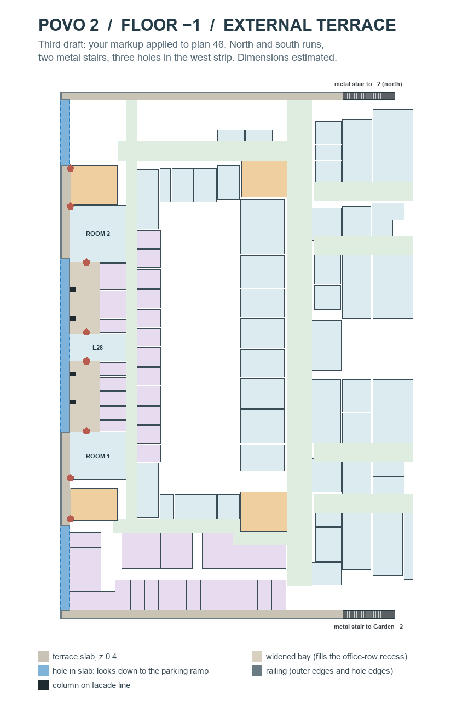
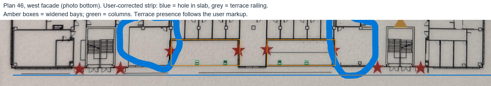

# Povo 2 −1 external terrace (third draft)

29 October 2026. The user's corrected Draw.io plan now controls the terrace:
red means terrace present; light blue means a hole looking down onto the
parking exit ramp. This supersedes the second draft's interpretation of the
missing outer line in photo 46.

The terrace is **444 m²**, at z 0.4 m, with 1.1 m railings. It includes both
the south and north runs, two metal stairs and the two widened office bays.
Three holes remove 65.7 m of the west strip. All eight west-façade exits still
land on terrace.

This is review geometry beside the West Offices layout. It reads
`exports/povo2_west_offices_20261029/layout.json` without changing it. It is
not integrated into the installed CS2 map or the previously built package.

## Applying the user's markup

The source is
`data/reference/user_feedback/2026-10-29/Povo2_Minus1_Terrace_Corrected.drawio`.
Its rectangles are registered against the embedded second-draft image. Their
coordinates, interpretation and adjustments are recorded under `user_markup`
in `config/povo2_minus1_terrace.json`.

- The south run now includes the south-west corner.
- Red west strips run alongside Room 1/core 4 and Room 2/core 3.
- The strip outside both widened bays and L28 is a continuous hole. The bays
  themselves remain terrace, serving the sideways room exits.
- A hole continues north of core 3 up to the new north run.
- The unmarked south-west stretch retains the earlier hole, ending at the
  red strip beside core 4.
- A north run spans the façade, with a second metal stair at its east end.
  The markup places it roughly 4 m beyond the base façade; photo 46 shows
  the matching stair beside that façade, so the run is snapped to the exact
  C5/C8 corridor ends, north 105.384615 m. Keeping that coordinate avoids a
  5 mm overlap caused by rounding to 105.38 m.

There are no isolated door landings cut into the holes in this version: the
four core/Room 1 exits now open onto the two continuous red strips. Railings
guard the strip's outer edges and every slab boundary adjoining a hole.

## Geometry

Bounds are campus metres: east minimum…maximum, north minimum…maximum.
Values below are rounded; the JSON retains the fitted coordinates.

| Part | East | North |
|---|---|---|
| South run | −25.45…31.8 | 0.29…2.0 |
| West strip beside Room 1/core 4 | −25.45…−23.74 | 19.2…38.06 |
| West strip beside Room 2/core 3 | −25.45…−23.74 | 73.3…92.15 |
| North run | −25.45…31.8 | 105.384615…107.094615 |
| Bay Room 1–L28, before O16–O20 | −23.74…−17.5 | 38.06…52.46 |
| Bay L28–Room 2, before O13–O15 | −23.74…−17.5 | 58.0…72.46 |
| South-west hole | −25.45…−23.74 | 2.0…19.2 |
| Middle hole | −25.45…−23.74 | 38.06…73.3 |
| North-west hole | −25.45…−23.74 | 92.15…105.384615 |
| South metal stair | 31.8…42.3 | 0.29…2.0 |
| North metal stair | 31.8…42.3 | 105.384615…107.094615 |

Each stair has two ten-riser flights and a 1.1 m mid-landing, descending
east from z 0.4 to −3.2. The OBJ uses thin sloping handrails with posts,
level over each landing. Four columns remain inside the widened bays.

The holes interrupt the walk along the west side. Each stair reaches its
own full north/south run; the other terrace sections are accessed through
the building exits.

## Evidence and unresolved registration

Photo 46 still supplies the terrace width (1.71 m), bays, columns and stair
shape. The evidence overlay shows the corrected west segments against the
photo; the Draw.io markup takes precedence for whether terrace exists.

- **South garden alignment remains unresolved.** `config/povo2_gardens.json`
  places Garden −2 at north 8.75–20 and its UP stair at east 33.25–35.75,
  running north–south. Photo 46 places this terrace stair at north 0.29–2,
  running east. The review follows photo 46; it does not move the garden.
- **The north stair's destination level is assumed.** It mirrors the south
  stair down to −2. No north garden or connection beyond its foot is modelled.
- **Parts of the base façade are missing.** The south-east trace stops at
  north 6.92 east of east 20.3; the north-west block has no traced rooms; and
  the north-east rooms end short of the north run. These are gaps in the
  base review layout, not evidence for moving its rooms.
- **A line crosses the Room 1–L28 bay** at east −20.56. Its meaning is unknown;
  it is not built. The columns suggest an overhang, but no roof is modelled.
- Photo registration, opening dimensions and railing details remain estimates.

## Reproduce and check

Run `py -3 -m tools.build_povo2_minus1_terrace` to regenerate
`exports/povo2_minus1_terrace_20261029/`:

- `terrace.json` and `terrace.obj`.
- `minus1_with_terrace`, `west_facade_detail`, `south_run_detail` and
  `north_run_detail`, each as PNG and SVG.
- `plan46_terrace_evidence.png`.

Run `py -3 -m unittest tests.test_povo2_minus1_terrace -v` for geometry checks:
unchanged base, no overlaps with rooms/cores/corridors, the user's red/blue
segments, holes free of slab, hole guards (including a missing-rail negative
check), both stairs meeting their runs, flood-fill reachability, north-run
alignment, office-bay fit, all eight west exits, continuous west-edge coverage
and columns within the bays.

Validation on 29 October 2026: all 15 terrace tests passed; the full
`py -3 -m unittest discover -s tests -q` suite passed all 318 tests in 110.9 s.
The generated PNGs were inspected, source hashes verified, and both OBJ
stair handrails checked for the correct slope and 60 mm rail thickness.
The full test log is `build/terrace-commit-tests-20261029.log`.

The successful campus build in `build/handoff/20261029T140538256109Z` predates
completion of this review. It does not validate or install the terrace.

## Native CS2 test — 29 October 2026

The committed terrace OBJ from `5c0ec41` was compiled as both render and
collision geometry in the separate `povo2_terrace_native_test` map. This
uses the unchanged OBJ at campus scale, neutral review shading, daylight
and a separate catch floor at z −3.2. No campus package was replaced.

All **12 ordinary-walking routes** passed, including both stairs with their
full north/south runs, both west strips and both office bays, each in both
directions (**28 waypoint checks**). Each of the three hole-centre drops
reached the catch floor at −3.2 rather than stopping at the terrace. Both
west-strip railing pushes blocked the standing player at terrace level.
These **five collision checks** also passed. CS2 was closed after testing.

This verifies the terrace mesh in CS2; it does not resolve its garden
registration or test connections to the campus building's doors.

- [Native result](../exports/povo2_minus1_terrace_20261029/runtime/native-test.json)
- [South stair screenshot](../exports/povo2_minus1_terrace_20261029/runtime/south_stair.png)
- [North stair screenshot](../exports/povo2_minus1_terrace_20261029/runtime/north_stair.png)
- [Middle hole screenshot](../exports/povo2_minus1_terrace_20261029/runtime/west_middle_hole.png)

Reproduce with Steam running and CS2 closed:
`py -3 -m tools.playtest_povo2_minus1_terrace`.
The command builds a separate test map, launches a solo session, records
results/screenshots and closes that session. `--run-only` requires unchanged
source and compiled resource hashes from a preceding build. Compiler and
console logs are kept in `build/terrace-native-test/`; movement results and
screenshots are in the review's `runtime/` directory. Three additional unit
tests ensure the runner rejects another map, loading or multiplayer sessions,
and revokes authorization when another player joins.
