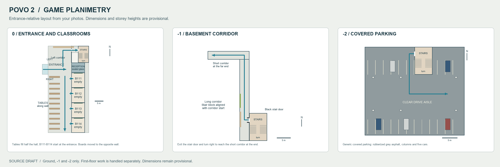

# Povo 2 game planimetry - revised 23 October 2026

**24 October update:** the generated review now includes B111–B114, boards on
the opposite wall, tables extending to the hall midpoint and a ground corridor
ending at the last classroom. See [the map adjustments](POVO_MAP_ADJUSTMENTS.md)
for the integrated playable build; the original checkpoint below is historical.



This is the corrected standalone source draft. The user's first-floor work is
separate and its panel has been removed from this review. No compile,
deployment, or game operation was performed for these layout corrections.

## Ground-floor correction

Entering from the west, reception is ahead behind continuous opaque frosted
glazing. Turn right to face south down a longer corridor. Twelve tables follow
the west/right wall all the way towards the far end. The classroom doors are
opposite them on the east/left wall, aligned flush with the reception front
at local east coordinate 21 m. B110-B113 run along that side, with empty
interiors, grey floor tiles and a blackboard on each south wall: the player's
right when entering the classroom facing east. Photo 12 establishes this
table/door arrangement; the earlier drawing wrongly put the rooms across the
far end of the hall.

The reception front wall continues north/left, screening the space behind it.
A stair-access opening leads through this wall into the draft stair vestibule.
The reception itself has no entrance. Dimensions, corridor length, table count,
and classroom spacing remain estimates.

## Basement correction confirmed by the user

The stair block's south/bottom edge aligns with the start of the long corridor.
The stair door opens directly into its east/right wall near that start. This
replaces the previous one-third position. The short corridor branches
from that end, reached by turning right/north when exiting the stair door
facing west. It is no longer a short approach corridor between the stairs and
the long corridor. The black stair-door leaves are shown on the plan.

Photos 3-1 guide the narrow tiled corridor, ceiling, black doors, green accent
wall and display case. Parking remains the previous generic covered layout
with grey rubberized asphalt, columns, bay lines and five simple cars.

## Validation and coordination

The standalone audit checks 29 stations across ground, basement and parking,
one local upper landing station, and 75 draft stair/landing support/headroom
samples. All pass. The upper landing check does not establish a connection to
the user's independently edited compact first-floor stair. Eight Povo 2 tests
cover the corrected table/room sides, empty rooms/right-hand boards, reception,
basement topology, draft stairs, clearance and radar packaging.
The complete current Python suite passes all 109 tests.

The renderer and audit now use tools/povo2_planimetry.py directly instead of
requiring the full campus to enable this draft. The user's compact first-floor
build keeps its compact_arrival gate and remains independent. Its geometry,
config, compile/deploy process and owned tests were preserved. The review now
contains only ground, -1 and -2. The obsolete first-floor reference image has
been removed, and the renderer no longer loads or displays it.

The draft lower-floor stair core still needs alignment with the compact W1
stair before integration into the playable campus. The current gate deliberately
keeps the full draft disabled during that build. The standalone OBJ and plan
are available for layout review now; they do not represent an installed package.

```powershell
python tools/audit_povo2_planimetry.py
python -m unittest discover -s tests -q
# Needs Pillow (available in the bundled workspace Python):
python tools/render_povo2_planimetry.py
```

Sources: config/povo2_planimetry.json, tools/povo2_planimetry.py,
tools/render_povo2_planimetry.py, and tools/audit_povo2_planimetry.py.
Source artifacts, provenance and clearance report: exports/povo2_planimetry/.

Coordination note for the compact-first-floor build: the standalone audit and
radar tests no longer require levels[1]['connection']['povo2']. No changes
were made to the compact connection config/generator, its gate, nav/sign
handling, or the campus audit/tests owned by that work. One draft-only service
rectangle in the existing optional povo2 radar branch follows the corrected
reception wall. No build, deployment, or runtime action was invoked.
