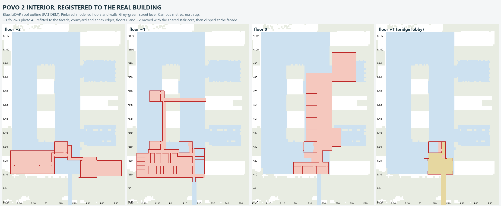

# Povo 2 registration to the real building — 30 October 2026

The user's walk in game showed the eastern entrance in the wrong place, and the
UP stair from their draw.io correction could not fit before the road. Checked
against the 2024 orthophoto and the PAT LiDAR surface model, two measurements
were wrong:

| | Real | Before |
|---|---|---|
| Povo 2 south facade | N 10.25 (LiDAR roof edge; the bridge lands here) | −1 offices N 2.0, floor-0 rooms N 0.5 |
| Courtyard | E −5.0…7.75, N 33.5…88.8 | E −4.5…10.5, N 26.6…84.5 |
| Stair core | N ≈26–33 (raised roof band N 26.5–32.5) | N 18–26 |
| Bridge road carriageway | N −3.5…+3.5 | N −8…−2 |

The campus frame itself is right: it is EPSG:25832 minus (666250, 5103800)
with no rotation, and Povo 1's north facade matches the LiDAR at N −20. The
exterior Povo 2 shell, the −2 garage model, the east entrance annex and
Garden −2 were already in place. Only the assembled interior was off: shifted
about 8 m south and, on −1, stretched east–west.

## Registration

`tools/povo2_registration.py` runs after all the interior passes and moves the
whole Povo 2 interior, geometry and metadata, with one separable piecewise-
linear map (`config/povo2_registration.json`):

- **North–south:** N = 8.25 + 0.9532 n, a least-squares fit on the facade and
  both courtyard edges.
- **East–west:** knots at the west facade, the courtyard west edge, the stair
  core and the east annex edge (E 51.75). C5 lands under the bridge,
  E 17.0–19.0, as the user saw on the orthophoto, and E1/E2 end on the real
  building edge (E 25.8 vs 25.75).
- **Stair core:** kept at true size (slope 1 on both axes), so the shared
  stairs are not distorted. It lands at E 7.5–17.0, N 25.4–33.4.
- **Bridge lobby:** the floor-1 arrival lobby stays pinned at the facade and
  stretches back to the core. The bridge, Povo 1 and Garden −2 do not move.

Three details keep the moved interior playable:
- Interactive door pairs are re-centred at their original width, and their
  walls or glazing re-cut, because the warp narrows openings by up to 20%.
- Floor and ceiling slab edges are carved out of the standing hull along
  every stair walking path.
- Metadata shared between the Povo 2 spec and the bridge link is moved once.

`build_geometry(registered=False)` keeps the assembly frame for the −1 layout
review tool. Tests that held assembly-frame numbers now map them through
`Registration`.

## South front (user draw.io, 30 Oct)

`tools/povo2_south_front.py` builds in real metres after registration
(`config/povo2_east_entrance.json`, `south_front_real`):

- **Road:** moved 5 m north onto the orthophoto carriageway, with its
  footways, joints, crosswalk and the abandoned bus. It tapers back at the
  E −36 bend and along the climbing segment to E 50, where the front link
  stays put. The bend's footway is clipped off the garage ramp mouth.
- **Pavement:** a street-level strip at N 4.4–7.5, with a railing along the
  terrace. East of E 32 it sits at the garden street level, with an earth
  bank down from the climbing road. A grass verge fills the old road strip.
- **Terrace:** 2.4 m deep (N 7.7–10.1), along the whole south facade. The
  LiDAR shows the sunken strip at N 8.0–10.3.
- **UP stair:** straight from the terrace to the pavement, in line with C5,
  20 risers over 3.3 m. It is steep; the user accepted that.
- **Metal stair:** from the terrace's east end into Garden −2, two flights
  with a mid-landing. Garden −2 now extends west to the building, as the
  LiDAR shows, with a northern bay where the −2 corridor's garden door opens.
- **Removed:** the exit corridor, its landing, garden exit, locked lower door,
  the old UP stair, the street slopes and the street-side lawn. C5 is the only
  exit corridor.
- **Floor 0:** the south rooms are clipped at the facade and closed with a new
  wall and windows, and the classroom side aisles are re-carved to the
  standing hull. A new entrance hall in the real east annex joins the moved
  interior to the outdoor door bank.
- **Floor −2:** the parking lobe is clipped at the facade line, so there is
  no parking under the terrace or street.

## Not yet done

- **Floors 0 and −2:** they are registered with the shared core and clipped,
  not re-traced room by room. Their plans (photos 33 and 37) have only coarse
  candidate traces in `config/povo2_survey.json`. The −2 parking interior
  still does not join the real garage model north of the core.
- **Dimensions:** the terrace link geometry, E1/E2 interiors and the front
  heights are estimates.
