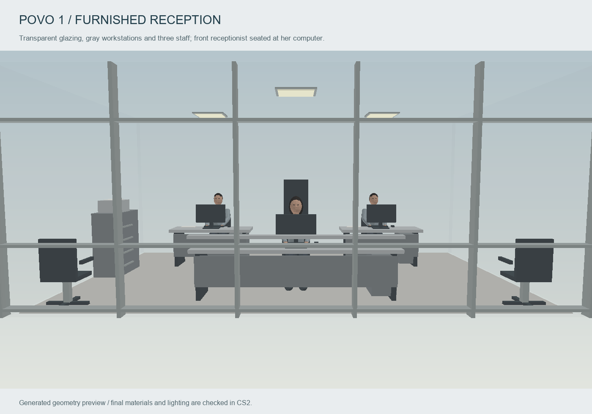
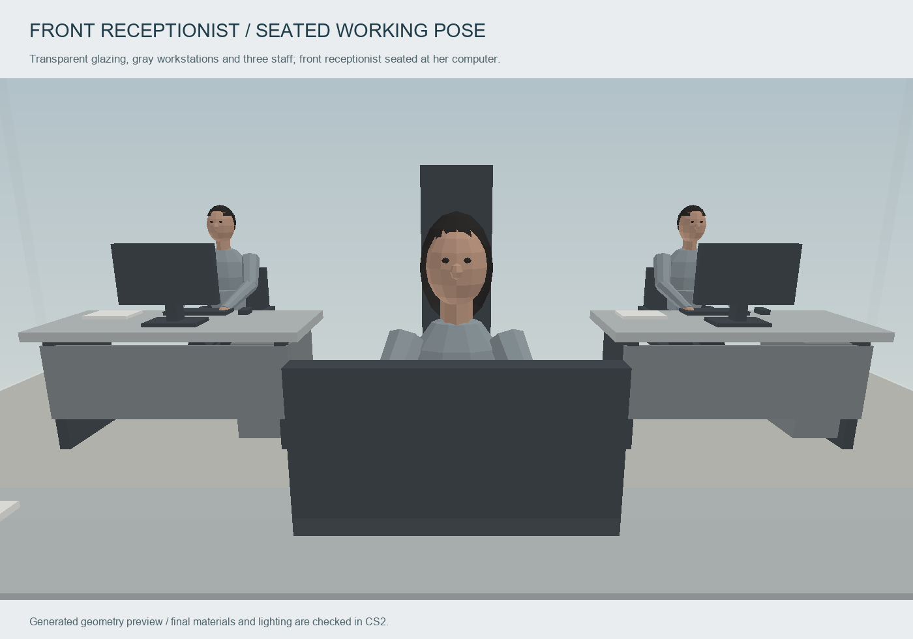
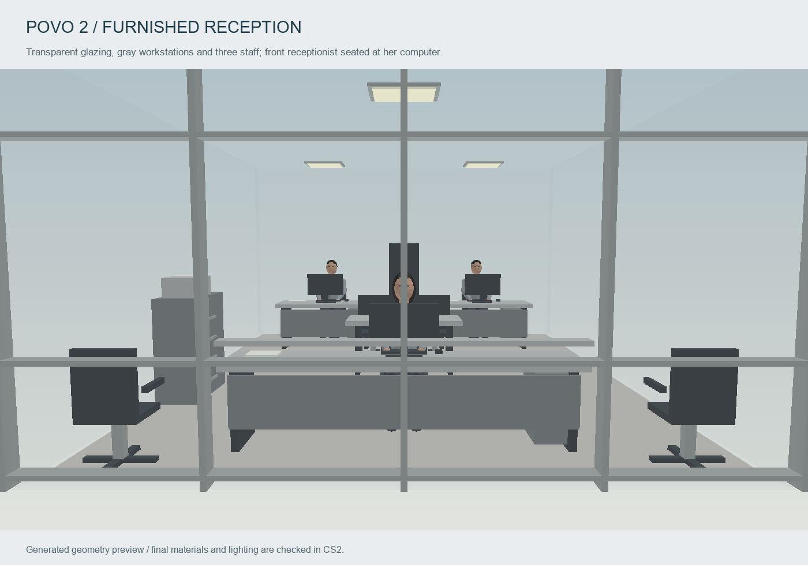
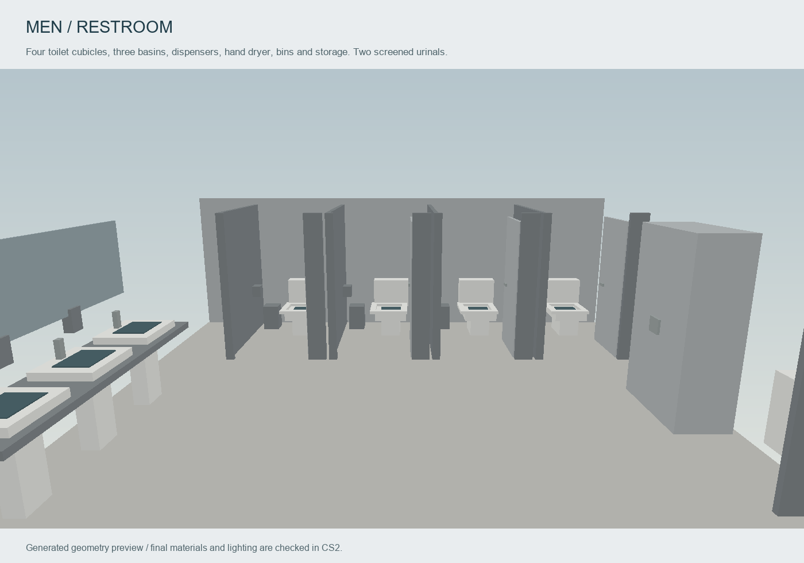
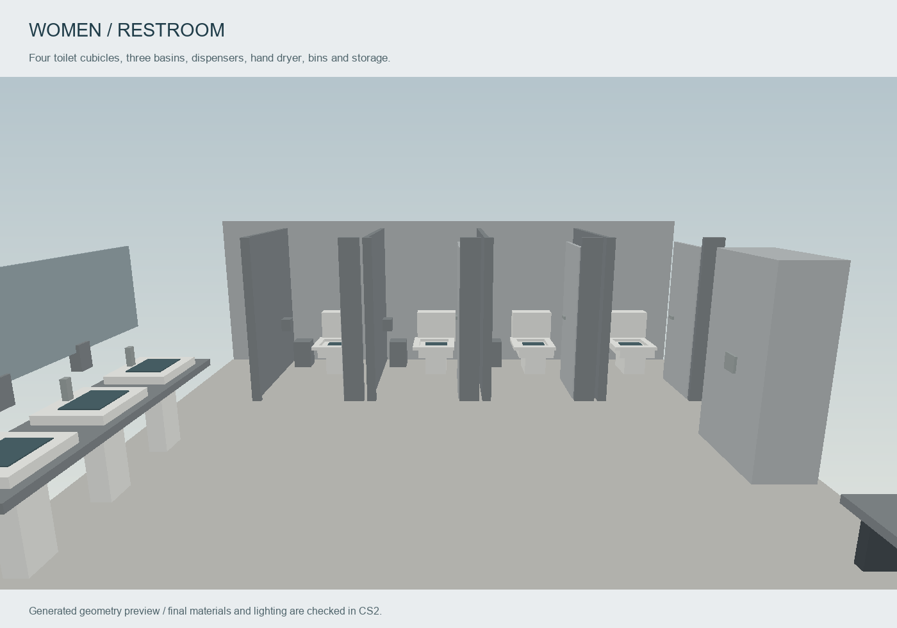

# Furnished receptions and expanded restrooms — 24 October 2026

Both receptions now share transparent glazing and a furnished gray office kit:
the front reception desk, two rear workstations, computer monitors, keyboards,
office chairs, visitor seating, filing drawers, printer and shelving. The larger
Povo 2 office also has a small meeting table and two extra seats. Ceiling lights
illuminate the offices through the glass.

Each office has three rounded, low-poly staff figures posed typing at their
computers. A woman sits at the front reception desk, with two men at the rear
workstations. These six static figures add 6,740 visual triangles and remain
inside the enclosed offices. Desks, seats, storage and clothing use muted grays;
skin and hair have natural subdued colors.

All four Povo 1 upstairs restrooms now have:

- Four toilet cubicles, with tanks, seats, flush buttons, door handles, toilet
  paper and an individual bin in each stall.
- Three basins on a counter, a long mirror, taps and soap dispensers.
- Hand dryer, waste bin and cleaning cupboard.
- A lower privacy screen behind the toilet row, with the existing upper
  courtyard glazing retained for daylight.
- Two urinals and a privacy divider in each men's room; a bench and hooks in
  each women's room.

The corridor-gray floor and separate UOMINI/DONNE entrance plaques remain.
The central approach and cubicle openings accommodate the existing 0.82 m
standing-clearance audit envelope.

## Source and validation

`tools/povo_interior_fixtures.py` supplies the furniture, sanitary fixtures,
office coordinate frames and staff meshes. The campus exporter includes the
staff faces alongside the retained backdrop. `reception_glass` maps to the
same proven transparent stock glass used by the campus windows. The exterior
entrance-door opacity is a separate material owned by the exterior integration.

All 36 targeted interior tests and all 131 combined source tests pass. The campus audit passes 65 ground,
120 upstairs and four compact vestibule stations. The integrated lower-floor
audit passes 33 stations, including the new exterior lobby station, and all
72 stair samples. Tests cover fixture bounds,
all cubicle and basin approaches, accessories, office desks, three complete
staff figures per office, mesh validity and the front woman's placement.

The software previews below show geometry before CS2's lighting bake. The
combined exterior/interior build is coordinated with the exterior chat; final
package and engine evidence will be added after that build.

