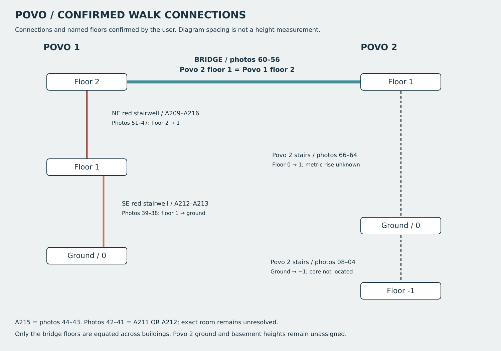

# Confirmed campus walk and floor connections

The user supplied 66 full-resolution WeTransfer JPEGs and narrated the walk.
The photographs and native camera metadata are retained under
`data/reference/povo_photos/walk_2026-10-23/`; P025–P090 are catalogue IDs, while
walk photo numbers continue to match `image000NN.jpeg`.

The bridge joins **Povo 2 floor 1 to Povo 1 floor 2**. This is a named-floor
height equality, not evidence that Povo 2's 0→1 climb equals two Povo 1 storeys.
Povo 2 ground and basement elevations remain unknown in the model.



The user used two different Povo 1 stairwells:

| Walk photos | Connection | Registered core / nearby rooms |
| --- | --- | --- |
| 51–47 | Povo 1 floor 2 → floor 1 | Northeast, A209/A216 |
| 39–38 | Povo 1 floor 1 → ground | Southeast, A212/A213; confirmed different |
| 66–64 | Povo 2 floor 0 → floor 1 | Core position not registered |
| 08–04 | Povo 2 ground → −1 | Core position not registered |

The detailed sequence is in `config/povo_circulation.json` and the
[photo route notes](../exports/povo_photo_walk_2026-10-23/ROUTE_NOTES.md).
Photos 44–43 are A215. Photos 42–41 remain A211 **or** A212. Photo 40's corridor
context and photo 14's outward view are contextual inferences. Photo 16 appears
in both entrance/outward groups in the user's wording, which remains flagged.
These do not block the confirmed floor and stair connections.

## Elevations and geometry limits

`tools/povo_circulation.py` validates complete photo coverage, the bridge endpoint
floors, distinct Povo 1 stair cores, connectivity of the six named floors, and
photo hashes. It propagates only the bridge equality between buildings.

The report records existing source estimates: Povo 1 ground 374.0 m, floor 1
377.6 m, and the old scenery bridge deck 382.49 m. Propagating the latter gives
the same **estimated** elevation to Povo 2 floor 1. Povo 2 floors 0 and −1 stay
`null`. These independent placeholders imply Povo 1 rises of 3.6 and 4.89 m;
the report flags the inconsistency for calibration. No new measured heights
are claimed or inferred from phone GPS. No exterior geometry was moved to hide
that uncertainty.

The current interior OBJ contains Povo 1 ground and floor 1 only. Floor 2, Povo 2
interiors, physical stair connections and the actual bridge route still need
geometry and Windows collision/navigation testing. This connectivity diagram
is not proof of a traversable game route. The existing compact outdoor arena
and collision remain unchanged.

```sh
python tools/povo_circulation.py
magick -background none exports/povo_circulation/review.svg exports/povo_circulation/review.png
```

The new high-resolution A215 photos support its courtyard-side window opening,
continuous dark desk fronts, shared metal supports and three-row fit-out. The
opposite glazing and external courtyard stair are recorded as window-background
references. That external stair has not been reconstructed yet.
