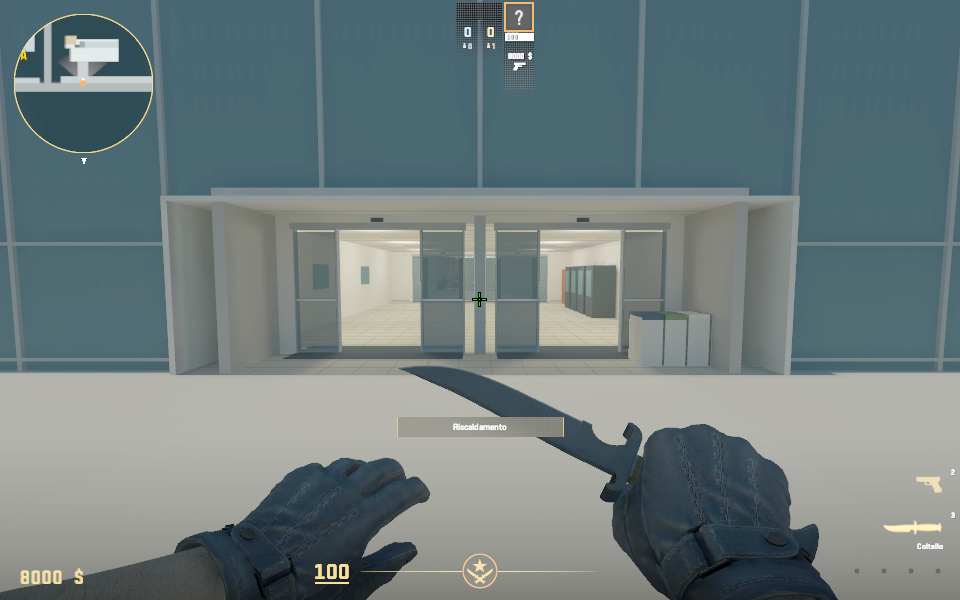
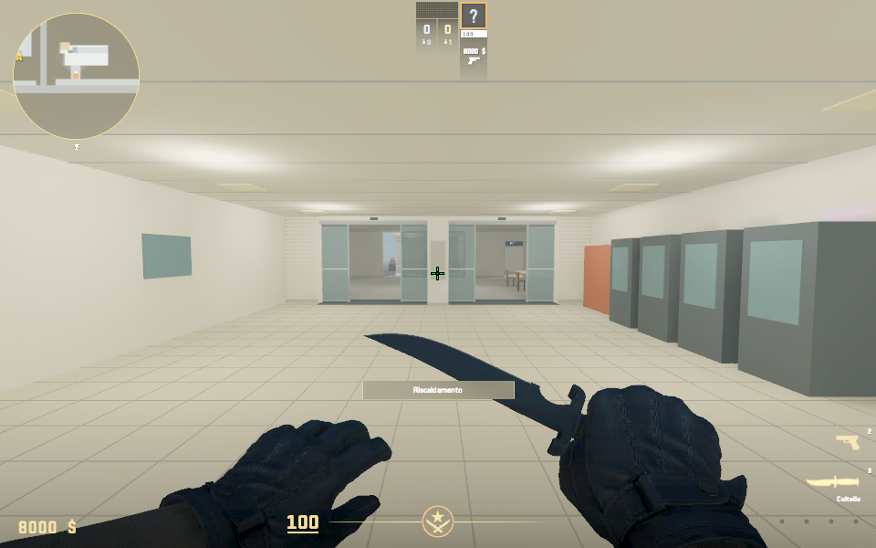
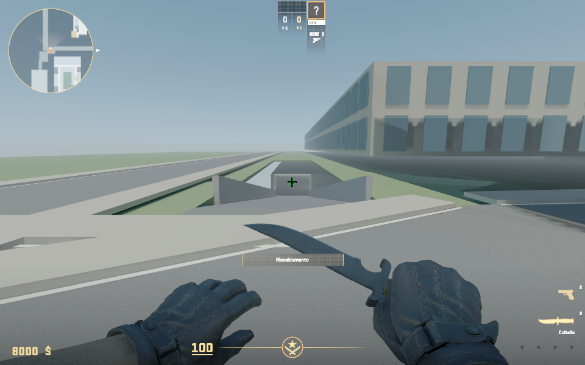
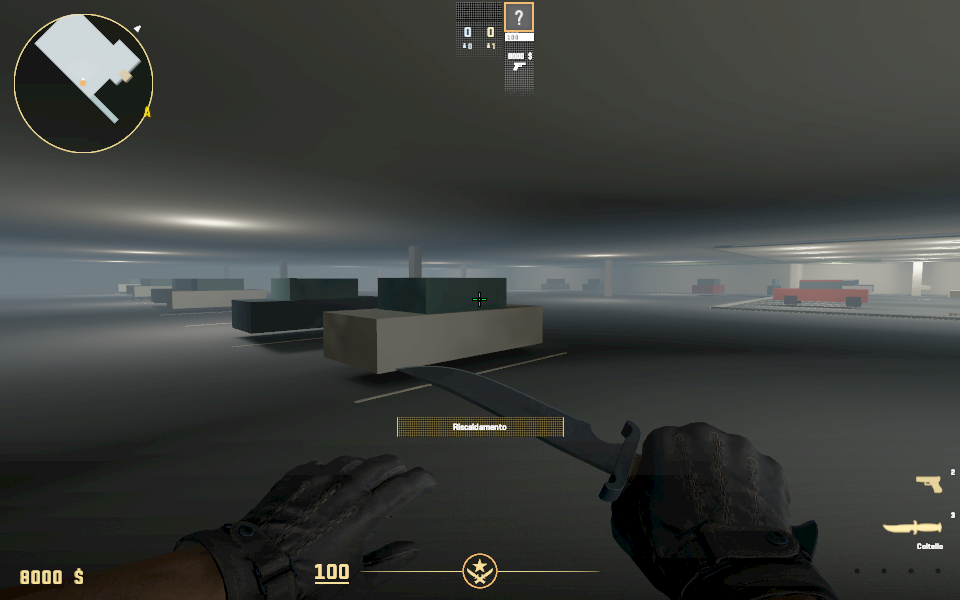
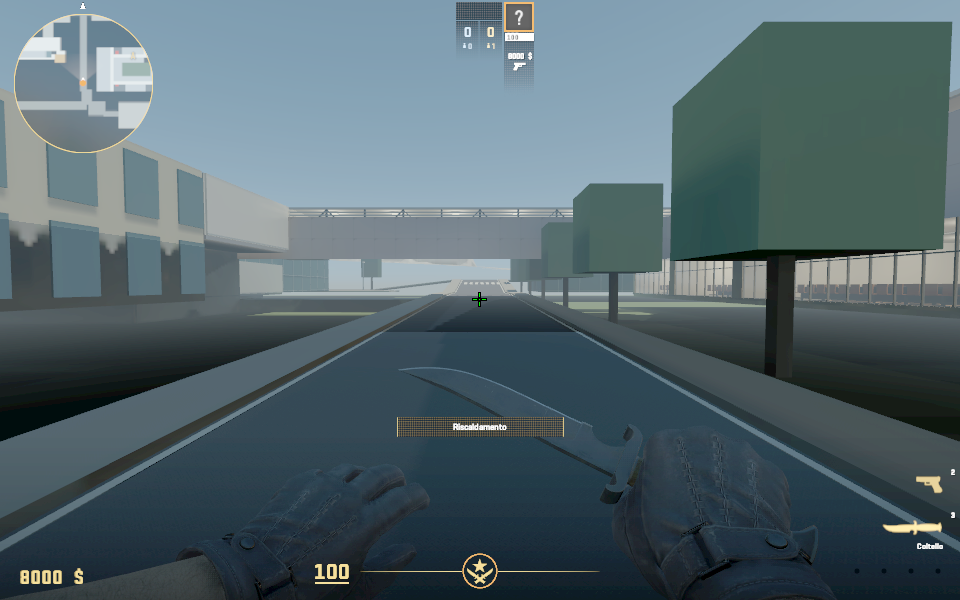
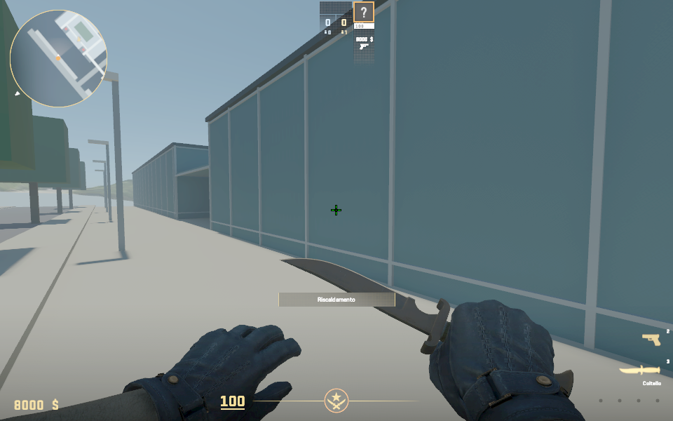
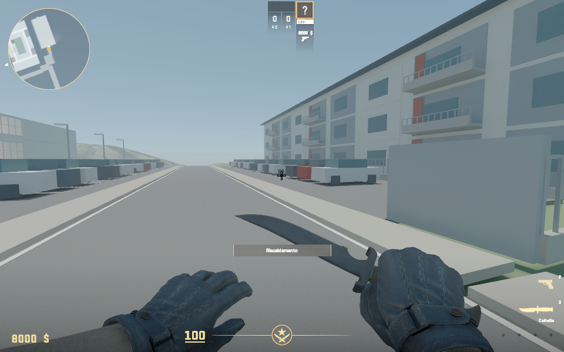
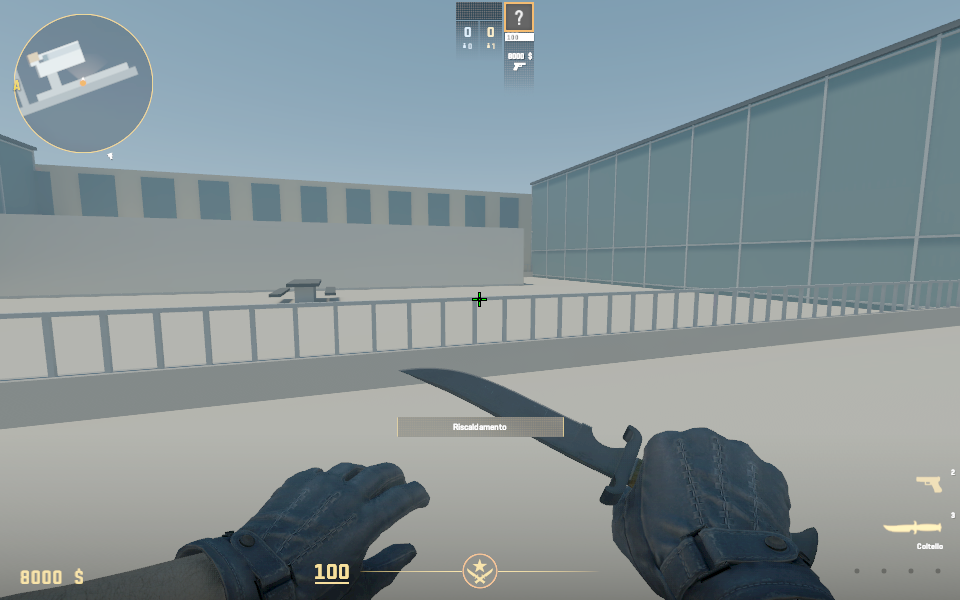

# Exterior planimetry — 24 October 2026

## Current integration checkpoint

The user approved integrating the full exterior and requested entrance panes
with 20% transparency (80% opacity). `build_povo_campus.build_geometry()` now
includes the exterior by default; `include_exterior=False` retains a base
snapshot for independent source reviews and regression checks. The integration
is isolated in `tools/povo_exterior_integration.py` and enabled by
`config/povo_exterior.json`. The reception/restroom chat released shared files
before the combined build; its furniture, reception material remap and 6,740
staff triangles are preserved.

Povo 2's exterior lobby and terrace now sit at z4, matching the playable
interior. The front street grades from the Povo 1 approach to this level.
Both door-bank routes open through the former entrance shell. Exterior parking
joins the existing parking through overlapping perimeter walls, retaining the
original stairs and fixtures. The ramp starts beyond the road/footway edge,
with a short level apron, avoiding a ceiling of overlapping street geometry.
The road beneath the bridge clears the existing basement roof; source clearance
under the adapted bridge remains over 3 m.

Sloped road/ramp meshes are included in native collision; terrain and old solid
backdrop are removed from the occupied exterior crop. Radar bounds now cover
both fronts, the north road, open surface lot and expanded covered parking.
Light probes, lobby/parking lights and exterior navigation seeds are extended.

The door material has its own `exterior/entry_glass.vmat`, separate from the
other chat's reception glass. The installed shader's feature resource establishes
the `TextureLayer1*` inputs; decoded compiled material confirms `F_TRANSLUCENT=1`,
`g_flOpacityScale=0.8`, and the intended custom colour/normal textures. Evidence:
`build/exterior-glass-compile.log`, `build/exterior-glass-decoded.log`.
Offline OBJ MTL opacity and the preview alpha pass use the same 0.8 value.

Source checks: 65/120/4 campus stations; Povo 2 8/8/17 stations and 72 stair
samples; 1,210 exterior route samples. All 135 source tests pass.

Backup: `build/exterior-integration-backup-20261024-121117/` (installed content,
game addon, and current editable source/config/maps). Combined build log:
`build/gameplay/exterior-integrated-build.log`.

## Compiled package and engine checks

The first combined compile did not finish: CS2's bot "Compute Approach areas"
pass ran for over 80 minutes on the open exterior's 9,210 nav areas (9 s for
the earlier 4,282 indoor areas). Its log is kept as
`build/gameplay/exterior-integrated-build-hung-approach-areas.log`.
Exterior builds now add a `trigger_survival_playarea` box (`skip_nav_analysis`
in `tools/cs2_campus.py`). In CS2's server code this class is read only by the
compiler's "Compute AI Data" step, which then skips approach areas, hiding and
encounter spots and early occupy times, as on Valve's large survival maps.
The nav mesh itself is still generated; bots lose those tactical hints only.

The rebuilt map compiled in 14.5 minutes with zero failures (the existing
duplicate-bone warning remains) and 9,210 nav areas. The reflection bake added
only `env_cubemap_array.vtex_c`; all 343 earlier entries are byte-identical.
Final package: **44,979,765 bytes / 344 entries**, all CRCs pass, SHA-256
`13973fad877f8070b5941295908b6865c70c3b7029bfe2b9fa80ed4ceabb52ba`;
local and installed test-addon VPKs match.

`tools/playtest_povo_exterior.py` passes all 21 waypoints on six routes with
normal walking and one placement per route: both Povo 2 door banks into
reception, the straight ramp down and back up, the covered garage into the
original parking, and the Povo 1 external stairs. Evidence:
`build/gameplay/exterior-runtime-walk.json`, `exterior-cubemap-compare.log`,
`exterior-final-verify.log`.

Unretouched engine screenshots (TGA converted losslessly to PNG):










These confirm that the geometry, lighting and transparency work in the engine.
They do not show finished art: the exterior remains blockout geometry, the
covered garage is dim and hazy, and the road beneath the bridge is in deep shadow.

The original editable exterior study is in
`config/povo_exterior.json` and `exports/povo_exterior/`. It covers the crossing,
road beneath the bridge, west bend, surface parking opposite A221–A224, the
residential backdrop, the road to Povo 2's north end, covered Povo 2 basement
parking, both east-facing fronts, entrances, terrace and street approaches.
Its approved geometry is now included by the campus generator as described above.

## Review

- `exports/povo_exterior/layout_review.png`: north-up aerial comparison and plan;
  gold lines are the four west-facing room axes; cyan is the garage ramp.
- `exports/povo_exterior/window_views.png`: four perspective studies, with
  camera locations and window frames derived from the current campus builder.
- `exports/povo_exterior/fronts_review.png`: whole-campus front overview,
  Povo 1 entrance passage, Povo 2 entrance blocks/terrace, and a garage cutaway.
  The covered parking roof is removed only from that labelled inspection view;
  it remains in the exported OBJ.
- `exports/povo_exterior/povo2_double_entrance_review.png`: street entrance,
  lobby in both directions and inner reception doors. Both sliding-door lines
  have two side-by-side banks, with their leaves parked open.
- `exports/povo_exterior/povo_exterior.obj` and `.mtl`: geometry in the existing
  campus frame, origin E666250 / N5103800 / elevation 370 m. Units are metres.
- `exports/povo_exterior/provenance.json`: source hashes, meshes, cameras,
  estimated dimensions, the exterior garage portal and separate interior alignment.
- `exports/povo_exterior/photo_catalogue.json`: new photo aliases, hashes,
  capture time and native GPS/heading metadata. Originals are preserved.

The PNG files are offline source previews; native engine checks are separate.

## Photo interpretation

| Original | Review alias | Evidence |
| --- | --- | --- |
| IMG_2364 | bridge_road_east_portrait | Road beneath the bridge, fences and footway |
| IMG_2365 | bridge_road_east_wide | Both campus facades and bridge |
| IMG_2366 | west_bend_povo2_garage_access | West bend and partly occluded entrance on the right |
| IMG_2367 | west_road_surface_parking_approach | Povo 1 facade, parking approach, residential backdrop |
| IMG_2368 | surface_parking_gate_residential | Curved fence, gate, white/grey facade and coloured recesses |
| IMG_2369 | surface_parking_two_rows | Gate, two rows of cars, lights and wooded edge |

The user confirms the right-hand entrance in IMG_2366 leads directly to Povo 2
parking and that the ramp **descends straight**. Both facts are recorded in the
configuration. The car hides much of the mouth. Its exact location, compass
heading, length, width, slope, level and portal remain estimates.

The older P019 view west from A224 anchors the parking arrangement and opposite
residential facade. P018/P023/P024 and walk photos 37–18 establish the Povo 1
entrance, external stair, crossing, Povo 2 approach and yard. Existing P009–P013
support the campus exterior material language. The 2024 aerial gives a
provisional footprint registration; the original approximate building envelope
does not turn it into a survey. No new internet assets were needed.

The new files were captured on 23 October 2026 at camera-native 15:29:13–15:29:56.
They were added to the workspace later. Their phone GPS accuracy varies by
several metres and altitude varies substantially between adjacent frames;
neither altitude nor magnetic headings are used as survey constraints.

## Built and provisional

### Povo 2 double entrance

The user explicitly confirmed that "double entrance" means the outer street
door line, long entrance lobby and inner door line into reception. Photos 24–23
show the recessed street opening and two adjacent sliding-door banks; 17–14
show the tiled lobby and ceiling; 13 shows the inner banks around a central
column. These original photographs are included in the export's hashed evidence.

`tools/povo2_exterior_entrance.py` replaces the southern glass annex's solid
placeholder with a hollow lobby. It cuts the old facade grids out of the
walking routes, adds tiled flooring, ceiling/lights, neutral vending/locker
proxies, a recessed exterior reveal, four sliding-door banks, fixed sidelights,
safety bands, sensors, mats and a reception-side central column. No signs,
logos or photographed screen/poster pixels are copied.

The outer doors are at local x49.4, recessed 1.6 m from the facade; the inner
doors at x34.5 match the live interior entrance's x/y location at y33.5.
Each line has two 1.8 m clear openings centred at y31.35 and y35.65. Leaves
are statically parked over their sidelights. The floor is continuous at local
z4.0. Lobby length, width and door dimensions are photo-guided estimates.

The earlier 1.8 m floor offset is resolved: both the exterior and playable
interior entrance are at z4.0. Native compilation and walking are separate
checks. Doors remain statically open. The separately pictured northern
street block is preserved rather than assigned another entrance without evidence.

The study includes graded road strips, footways, white road-edge/crossing
markings, parking-bay proxies, two rows of simple cars, fences and gate leaves,
lamps, planting proxies, a residential facade with balcony/recess rhythms,
bridge structure at the live source location, and entrance stair/canopy proxies.
The revised north road runs from the ramp mouth beside Povo 2 to its northern
end at local y112, then follows a short bend to y118. It remains at road level
while the adjacent straight ramp descends. The approved open surface lot and
residential backdrop opposite A221–A224 retain their original geometry.

Povo 1's east side now has two long glazed wings around the covered entrance
passage, a continuous front footway, canopy structure and stairs. Povo 2 has
two glazed front blocks, entrance doors/canopy, raised terrace, railings,
lightwell proxies, tables, planting and lamps. Stone core facades now have
east-facing and end-facing windows. A front street joins the original crossing
road. The annex footprints follow the existing geographic blockout and photos;
facade subdivisions and all heights remain estimates.
The distant ridge is a schematic mesh informed by P019, not measured terrain.
No people, plates, faces or photographic pixels are used as model textures.
Car counts, bay counts, facade bays and all exterior heights are estimates.

The Povo 1/Povo 2 blocks are solid context masses for the exterior review;
they must be excluded when merging with the playable campus. Window reviews
omit Povo 1's context mass and use the actual room window frames, omitting
glass for the software renderer. The interior geometry is not edited.

The straight ramp ends at local (-29, 30, -3.2) and now directly meets the
covered exterior basement footprint [-32.5, 30, 25, 112], part of the Povo 2
building podium. This includes a roof slab, perimeter walls, a 5.5 m clear
south portal, 3.4 m headroom, support columns and parking proxies. The basement
extends 9.5 m west of the simplified main core to meet the accepted ramp
position; its footprint is an adjustable exterior study assumption.

The interior parking begins at x=-1.5, 27.5 m east of the ramp endpoint.
Its overlap with the exterior garage is now opened through the perimeter walls;
the preserved interior floor/stair coordinates connect to the larger garage.
Provenance retains both footprint records for traceability. Native engine
walking is checked separately from the passing source route audit.

The current bridge uses the accepted two-floor adaptation. Its deck underside
is over 3 m above the integrated road at the crossing; this is a source clearance
check with assumed levels, not a measured real-world clearance.

## Rebuild and validate

```powershell
python tools/build_povo_exterior.py
python tools/render_povo_exterior.py
python -m unittest discover -s tests -p test_povo_exterior.py -v
python tools/audit_povo_exterior_integrated.py
python tools/audit_povo_campus.py
python tools/audit_povo2_integrated.py
python tools/cs2_campus.py
```

The builder uses the standard library. The renderer needs Pillow and numpy
(available in Codex's bundled Python runtime). The standalone renderer writes
its own export directory; the campus pipeline writes the combined source/addon.
Regenerate after interior room or bridge positions change.

Geometry tests cover ramp straightness/end levels, the covered garage portal
and roof, standing clearance into the garage, the north road extent, the open
Povo 1 entrance passage, explicit separate interior parking alignment, bridge
clearance, cameras inside the correct rooms, finite mesh coordinates, and
outward winding of closed sloping surfaces. Future integration
must refine the estimated terrain/elevations and validate collision/routes in CS2.

The earlier double-entrance study passed eleven exterior tests and 128 repository
tests. Standing samples cover both door-bank
routes from the street through both door lines, including support and clearance
against all exterior boxes. The generated plan, front/garage, window and double
entrance previews were visually inspected.
Current standalone exterior OBJ/MTL hashes and original photo hashes are recorded in
provenance; reference images are not deployed as textures.
