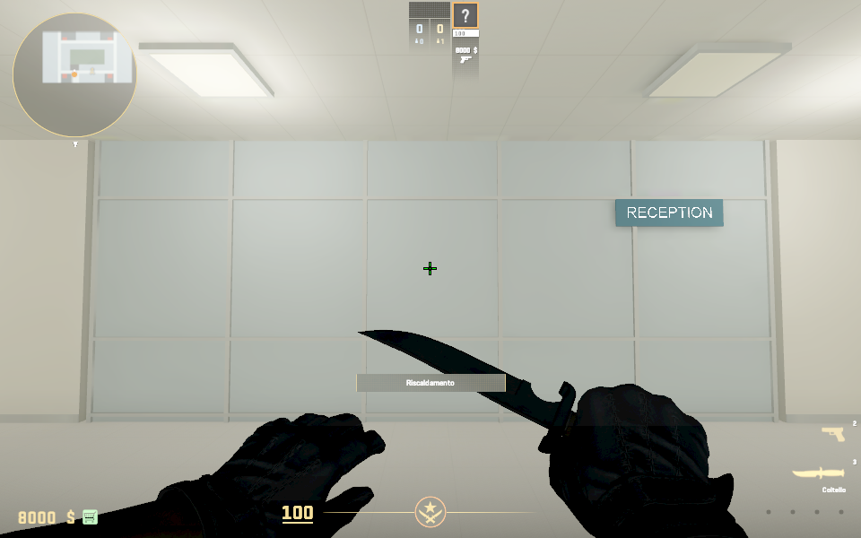
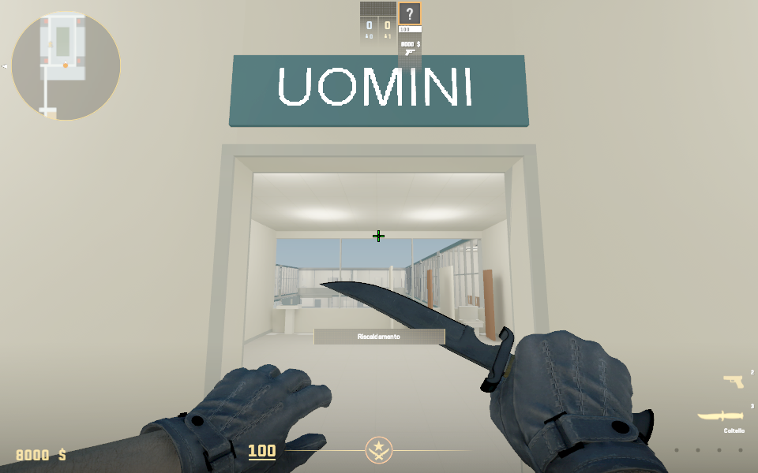
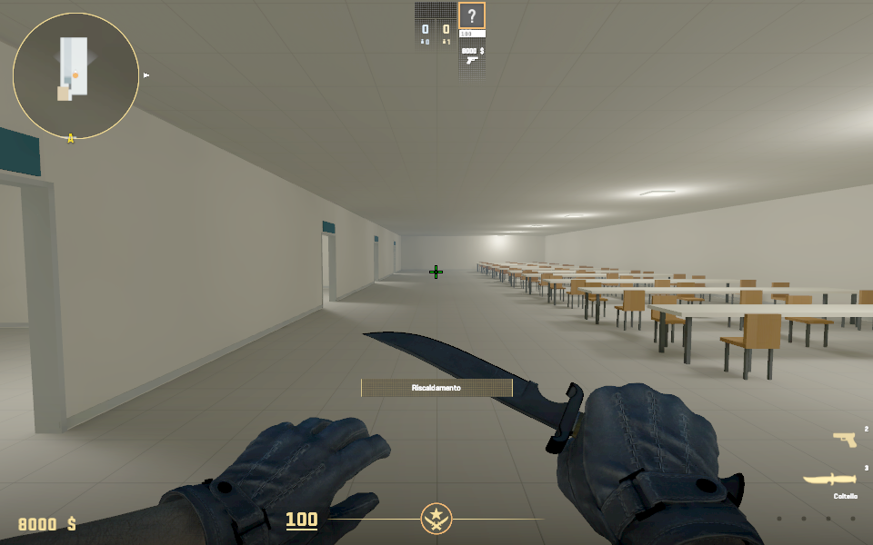
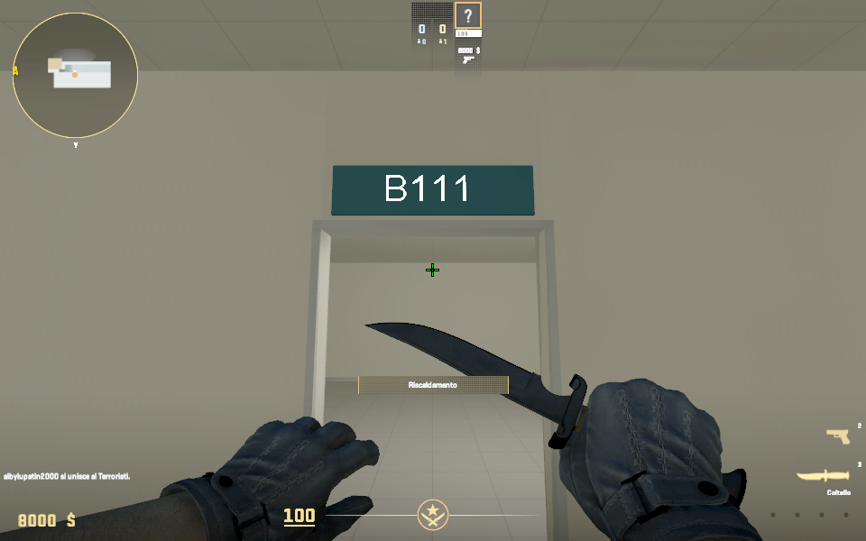
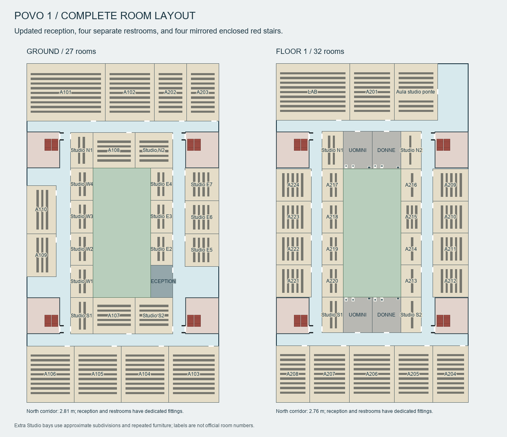

# Map adjustments — 24 October 2026

The user reviewed the integrated map and requested these changes:

- Povo 1 ground Studio E1 becomes a sealed reception facing the entrance. It
  shares the same frosted panels, frames and horizontal rails as Povo 2's
  reception; the classroom desks and board are removed. Its sign reads RECEPTION.
- Povo 1 circulation changes from RGB 222/221/214 to 184/184/179, retaining the
  subtle terrazzo finish. Room floors retain their existing color. Povo 2's
  grey tile changes from 169/170/164 to 158/159/154.
- Povo 2 ground tables extend to the hall's midpoint, leaving the classroom
  half open for circulation. Eleven rows remain after shortening the hall.
- The four Povo 2 ground classrooms are B111, B112, B113 and B114 in order
  from the entrance. Each board and its tray move to the opposite wall
  (south in the integrated world frame, north in the standalone drawing).
- Povo 2's ground shell, slab and ceiling end at the final classroom instead
  of continuing two metres beyond it. Basement and parking remain unchanged.
- Each former upstairs Aula studio N/S in Povo 1 splits into two independent
  restrooms. Both wings have UOMINI and DONNE signs above separate doors, using
  the existing room-sign system. All four rooms have corridor-grey flooring,
  two partitioned toilets with tanks/seats/bowls, and a washbasin, tap and mirror.
  Classroom furniture and boards are removed from those spaces.

The shared fixture generator is `tools/povo_interior_fixtures.py`. Layout
decisions live in `config/povo1_campus.json` and `config/povo2_planimetry.json`.
Dimensions remain approximate, matching the existing map's prototype detail.

## Validation

All 126 Python tests pass. Decoding the generated VMAP also confirms exactly
one RECEPTION, two UOMINI, two DONNE and one each of B111–B114, with the removed
study-room labels absent from the playable map.

The source checks cover reception enclosure, independent restroom doors and
sign plaques, sanitary fixture bounds and access to all eight cubicles and
four washbasins. The campus clearance audit passes 65 ground, 92 upper and
four compact-vestibule stations. The integrated Povo 2 audit passes 32 lower
floor stations and all 72 stair samples.

The previous installed source and game addon trees, test addon and packaged
map are preserved in `build/map-adjustments-backup-20261024-103106/`.
Compilation output is `build/gameplay/map-adjustments-build.log`.

## Playable package and engine review

The full map, lighting, navigation and eight radar textures compiled with
zero resource failures. The existing duplicate-bone warning remains. A later
entity-only correction moves the B111–B114 text planes beyond the plaque faces;
package entry hashes confirm that world meshes, collision, lightmaps and
navigation remain unchanged by that correction. The plaque generator also
keeps its faces behind the fixed text plane for future full builds.

Actual CS2 walking passes all four restroom entrances and stops at the shortened
Povo 2 end wall (local north coordinate 70.993 m at the player's centre).
Native engine screenshots verify reception, the grey circulation floor,
restroom fittings and UOMINI/DONNE signs, enlarged tables, the reversed board,
and all four visible B111–B114 labels. Screenshots are converted from TGA to PNG
without retouching. The map remains a prototype with estimated dimensions and
simple sanitary fixtures; the existing courtyard glazing remains.

The final reflection bake adds one cubemap entry while preserving every
pre-existing package entry. The final local and installed test-addon VPKs
match: **42,212,394 bytes / 217 entries**, SHA-256
`289ffd586414bdb425be2bb5390b60e40870a8bd08eb19ccceb63b4db45555fa`.
All 217 entry CRCs and packaged asset hashes pass. `play_campus.cmd` uses this
package. The final session is solo, no bots, normal walking and paused warmup,
at the Povo 1 entrance facing reception.

Evidence: `build/gameplay/map-adjustments-runtime.json`,
`map-adjustments-entity-compile.json`, `map-adjustments-final-runtime.log`,
`map-adjustments-cubemaps-final.log` and `build/package/trento_povo_campus.json`.

Updated source reviews:

