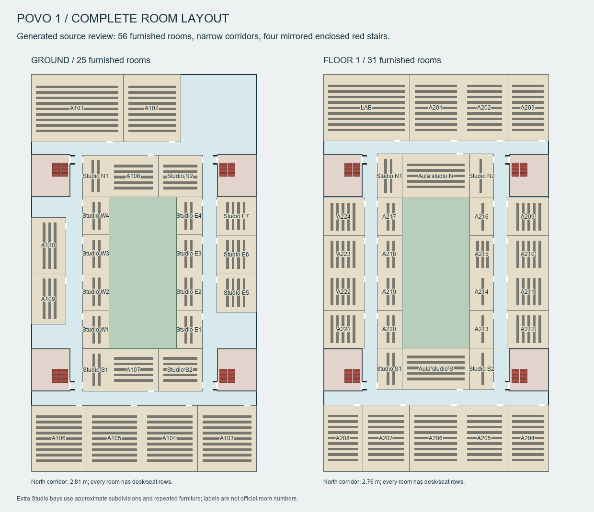
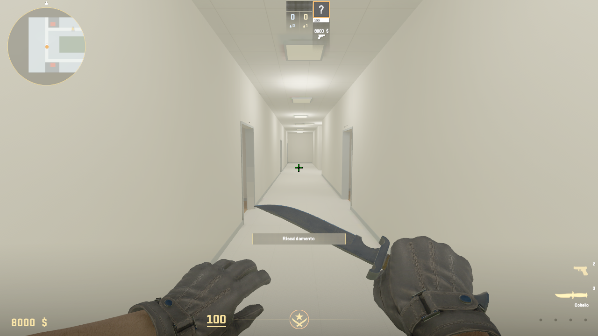
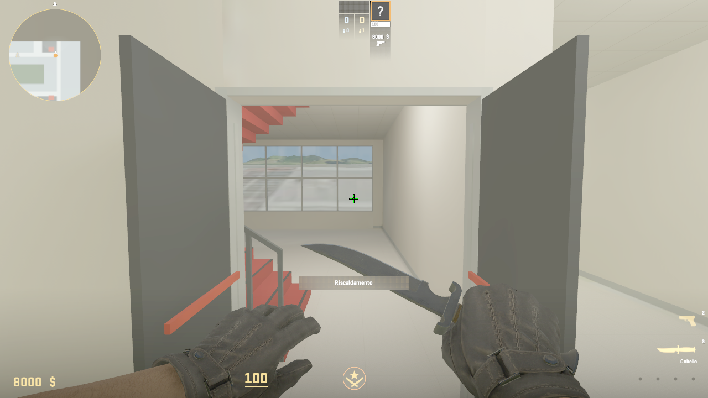
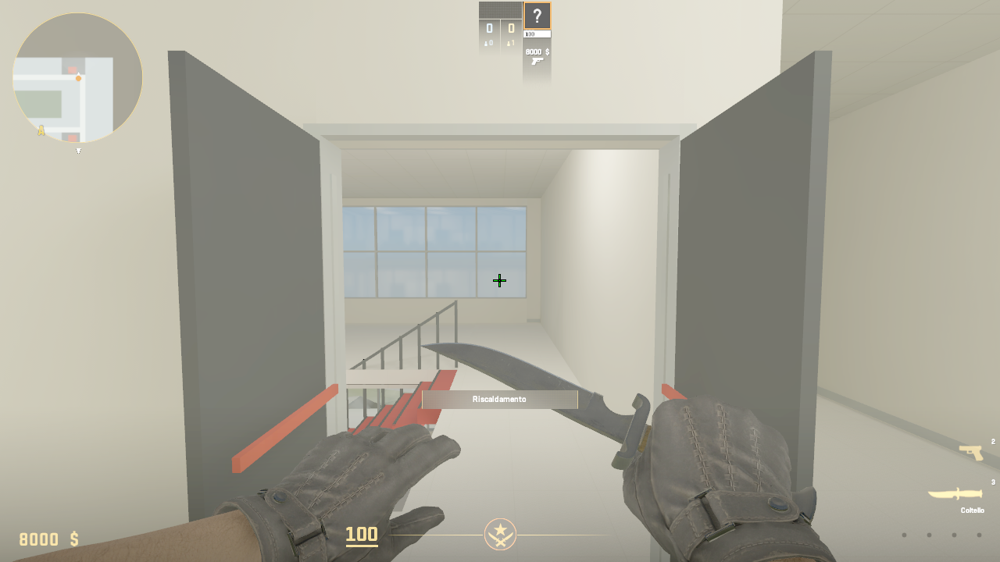
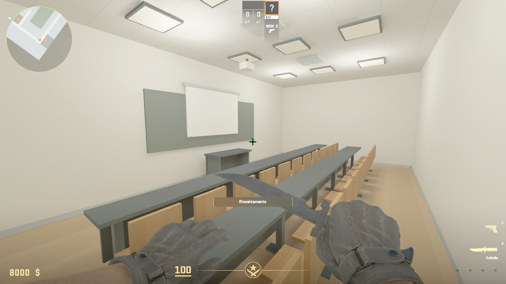
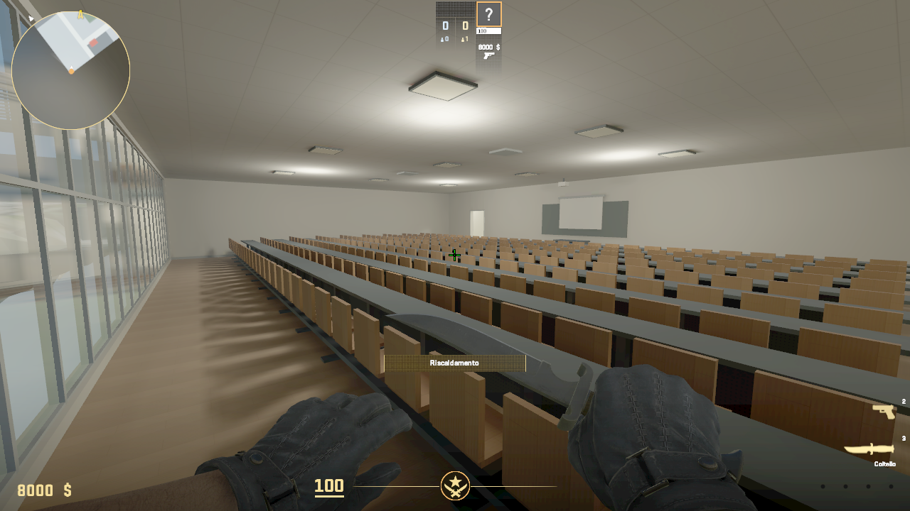
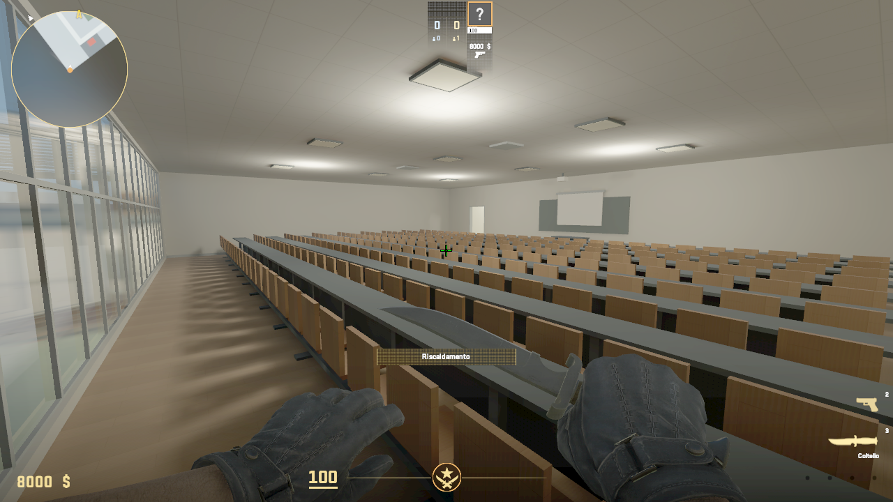

# Povo 1 complete rooms and four stairs — 23 October 2026

The revised layout opens and furnishes every room: 25 on the ground floor and
31 on the first floor. This includes A101/A102 and the lab/computer spaces.
New repeated study bays replace the broad empty corridor strips. The north
corridor is approximately 2.81 m wide downstairs and 2.76 m upstairs, with rooms
on both sides. Circulation floors now use a lighter off-white finish; classroom
wood floors remain. The added subdivisions and repeated furniture are estimates.

Four enclosed red stairs stand directly opposite Studio N1/N2/S1/S2. The
southeast prototype is reflected across the building axes to make the other
three: the same twenty 18 cm risers, 28 cm treads, 1.5 m flights, landings and
rails. The central Aula studio rooms are unchanged. Each stair has opaque walls
and open black double doors with red panic bars on both floors, guided by walk
photos 38–39. The first-floor slab and ground ceiling have four exact shaft
openings. The per-floor radar shows all four stairs.

The launcher defaults to a solo exploration session with no bots, paused warmup,
respawns and invulnerability. With CS2 closed, run `play_campus.cmd`; `-Fly`
starts in noclip and `-Match` uses match defaults.

All 97 source tests pass. The standing-envelope collision audit passes 63 ground
and 75 first-floor stations, including both sides of all eight stair portals.
These source checks do not themselves prove compiled-map stair traversal.

## Deferred Povo 2 connection

The user approved keeping Povo 1 at two floors for the later Povo 2 map. The
bridge corridor will start from the current A202/A203 area, and those rooms will
move to the corresponding empty ground-floor corner. This revision records
that decision in both campus configs and preserves their current positions.
The photographed three-storey route remains reference material.

## Build and runtime evidence

The final four-stair build log is `build/gameplay/campus-four-stairs-build.log`.
The compiled-map movement check is `build/gameplay/four-stair-check.py`; its log
and JSON record normal forward movement through each flight and each doorway.
Initial test placement uses `setpos`; walking uses noclip off and no jumping.

The model, map and four radar textures compiled with zero resource failures.
The map has 3,938 navigation areas. The model retains the earlier nonfatal
duplicate-bone warning; the compiler also reports the baseline missing optional
detail-prop file. Generated geometry has 15,673 visual boxes and 2,198 simplified
collision boxes.

All 40 compiled-map movement stages passed: six walking stages per core
(both flights up/down plus landing turns) and entry/exit through each of the
eight portals. Foot heights were approximately 157.5–158.0, 228.4 and 299.2–299.7
Source units. The initial half-second exit probe was too short to return to the
hall; allowing a full second completed the crossing without geometry changes.
The final successful transcript is `build/gameplay/four-stair-check.log` and its
JSON contains every measured position.

Reflections were baked in the isolated addon. Every prior packaged entry kept
its SHA256; only the cubemap array was added. All 147 entry CRCs pass. The final
package is 39,431,526 bytes, SHA256
`516c4c11b2914f388f73bffee3ef3a109f56122598be2771d40f081b17c1e029`.
Installed and build-package hashes match. Package details are in
`build/package/trento_povo_campus.json`.

Foreground CS2 inspection covered the north corridor, southeast and northwest
stair entrances, Studio N1, A101 and LAB. The engine screenshots below were
converted from TGA to PNG without retouching. Engine capture and foreground
desktop capture display different gamma; the foreground view is darker.

The final live state has one human, zero bots and `mp_warmup_pausetimer = 1`,
with warmup displayed without a countdown. The game is left running at the
ground entrance, facing into the building, with normal walking enabled.
The exploration helper also faces new sessions into the hall. Its three tests
pass after that final orientation adjustment. Logs are
`build/gameplay/campus-four-stairs-final-explore.log` and
`build/gameplay/campus-four-stairs-final-state.log`.

This remains a prototype with repeated furniture and simplified finishes.
Large rooms still show uneven lighting in the foreground view, and exterior
detail, competitive balance and an independent second-client match remain open.
