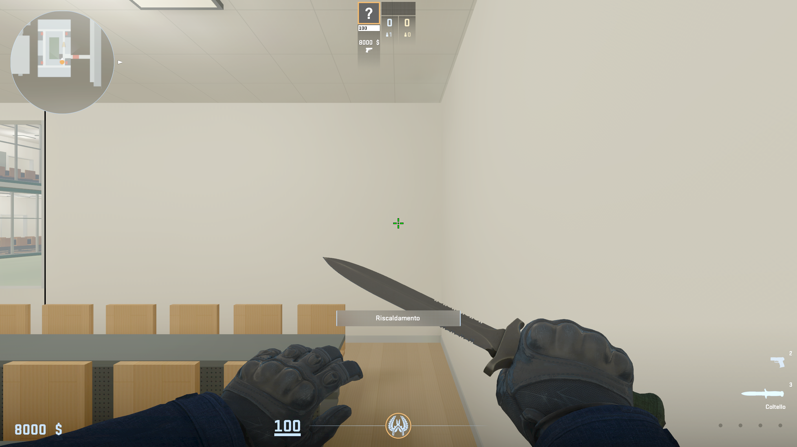
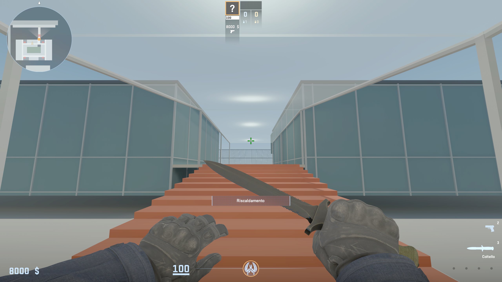
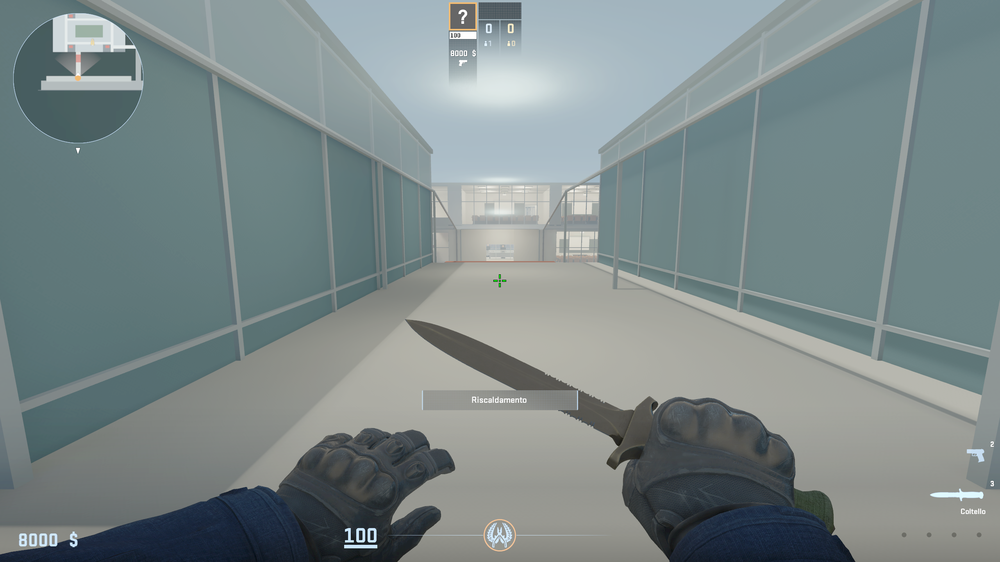
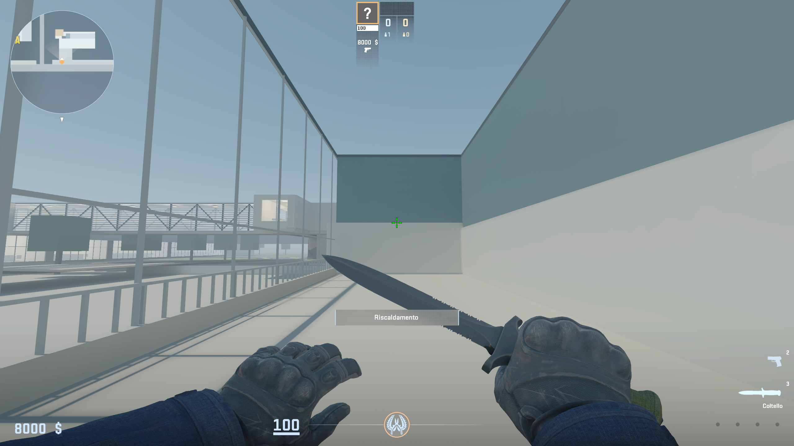
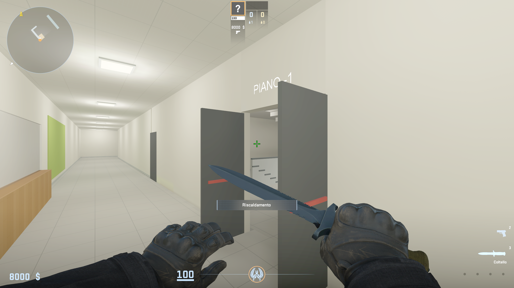
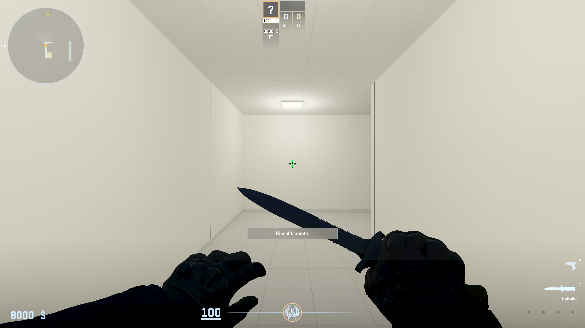
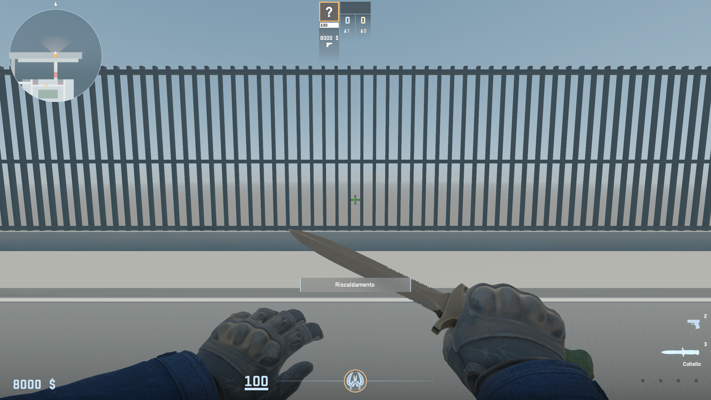
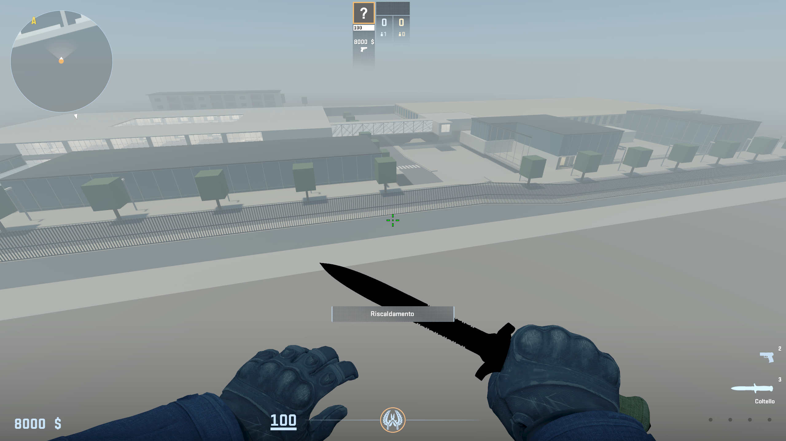

# User geometry corrections — 24 October 2026

The user's three game screenshots are preserved under
`data/reference/user_feedback/2026-10-24/`. They are review references only;
none of their pixels are deployed as game textures.

## Requested layout

- Ordinary rooms must have visible, opaque shared walls. Reception glazing must
  not remove the neighboring classroom partition. The generator restores all
  51 shared room boundaries after room/window/office conversions. Intentional
  room-to-room openings can be explicitly listed in `open_room_connections`
  by level in the campus settings; none are inferred automatically.
- Povo 1's exterior red stair runs straight out from the main entrance. A 3 m
  clear lower landing precedes twelve 15 cm rises. The last tread joins the
  continuous upper paving, without the former sideways turn. Local east runs
  from 27 to 36 m at north -73.73 m. The upper paving continues to the street.
- Semi-transparent glass covers the route from the exterior threshold at east
  24 m through the landing, stair and upper passage, ending at east 52 m before
  the street pavement. Glass opacity is 0.35; Povo 2 entrance panes retain 0.8.
- The missing Povo 2 terrace is **left when facing the entrance from the
  street**, as confirmed by the user. Its paving spans east 34.5–58 m,
  north 20–28.3 m, and connects directly to the street-side walk at level 4 m.
  The old solid annex proxy is removed from that space.
- The tall fixed gate/fence is **across the street from both entrances**,
  separating the road from the unplayable area. It follows the road grade at
  east 68 m between north -122 and 126 m, with 4 m of height. The street between
  Povo 1 and Povo 2 stays open. Three continuous collision volumes represent
  the closed fence, avoiding hundreds of separate bar hulls.
- At Povo 2 level -1, walking south down the long hall now turns **right/west**
  at its far end. The branch spans east 5–20 m, north -6.5–-3.5 m. Its audit
  stations, ceiling lights, source review arrows and radar follow the new side.
  Obsolete door leaves from the standalone stair draft and an orphaned door
  fragment are removed. Only the actual stair doorway's open pair remains there.
- Concrete covers the otherwise empty outskirts and the underside of the map.
  The occupied exterior crop retains structural collision. Distant concrete
  extends to +/-650 m and is visual context, using an unlit concrete material
  so it does not expand navigation or require enormous exterior lightmaps.

The architectural dimensions remain gameplay estimates. These changes implement
the user's layout corrections rather than claiming a measured campus survey.

## Source checks and rebuild

```powershell
python -m unittest discover -s tests -q
python tools/audit_povo_campus.py
python tools/audit_povo2_integrated.py
python tools/audit_povo_exterior_integrated.py
python tools/cs2_campus.py
```

All **146 tests pass**. Source checks pass 65/120/4 campus stations, 8/8/17 integrated Povo 2 stations,
72 stair samples, and 1,234 exterior samples on nine routes. Regression tests
cover opaque partitions, straight stair/paving continuity, glass-cover extent,
basement handedness/duplicate doors, fence placement and concrete coverage.

The prior installed content/game addon, package and working source are backed
up in `build/user-corrections-backup-20261024-175726/`. Native build evidence is
recorded in `build/gameplay/user-corrections-build.log`. Engine checks and the
final package identity are recorded below after the rebuild completes.

The launcher respects saved display settings by default. Pass `-Windowed` to
request the previous small review window explicitly.

## Compiled package and visual review

The model compiled in 949.756 s; the map compiled in 705.313 s with zero
resource compile failures and 9,633 navigation areas. The existing duplicate
bone-name warning remains. The shader decoder confirms canopy
`F_TRANSLUCENT=1`, `g_flOpacityScale=0.35`, and the outskirts' unlit shader.
Logs: `user-corrections-canopy-material.log` and
`user-corrections-context-material.log` under `build/gameplay/`.

The reflection-baked package is **44,632,576 bytes / 342 entries**, SHA-256
`a05d5d3adf6080d8797f343a8a29271e20a4fce0ef4a8be7f4b5afa0e35de860`.
The reflection bake adds only the cubemap; all 341 original entries retain
their source hashes. The package passes the CRC and map/model/configuration
checks. The installed dedicated test-addon copy matches this package.

Three native movement checks confirm that the restored classroom partition
and both street-fence locations block normal walking. Eight unretouched engine
captures are saved with their camera positions in
[`boundaries-and-captures.json`](../exports/povo_campus/runtime/user_corrections/boundaries-and-captures.json).
The concrete overview uses noclip for inspection; it is not a traversal claim.

The full native walking regression passes **41 waypoints on 13 routes**,
including the straight stair up/down, left terrace and right-hand basement
branch. Each route has one initial placement and uses normal walking between
waypoints. Evidence: [`exterior-runtime-walk.json`](../exports/povo_campus/runtime/user_corrections/exterior-runtime-walk.json).
All **342 CRCs and source asset hashes** pass again after the bake, and the
installed package hash matches: [`final-package-check.json`](../exports/povo_campus/runtime/user_corrections/final-package-check.json).
CS2 is left foreground in full screen, at the exterior Povo 1 entrance facing
the straight stair, with normal walking, one human, no bots and paused warmup.









