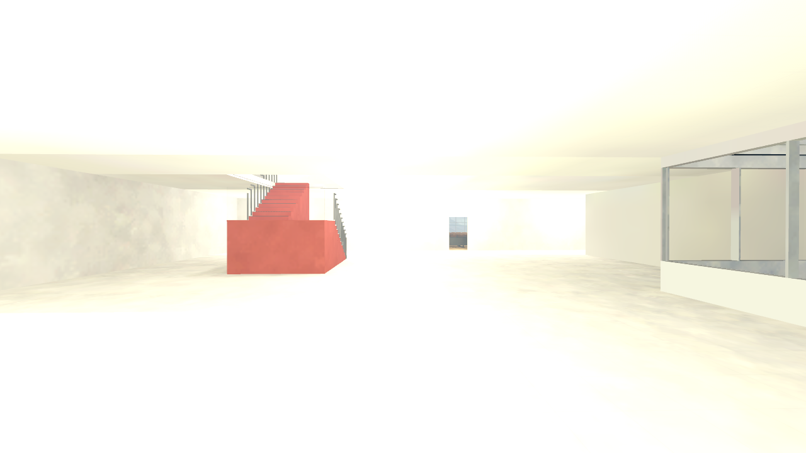
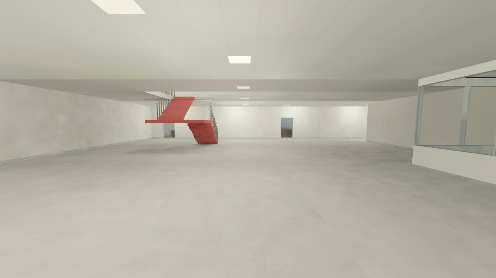
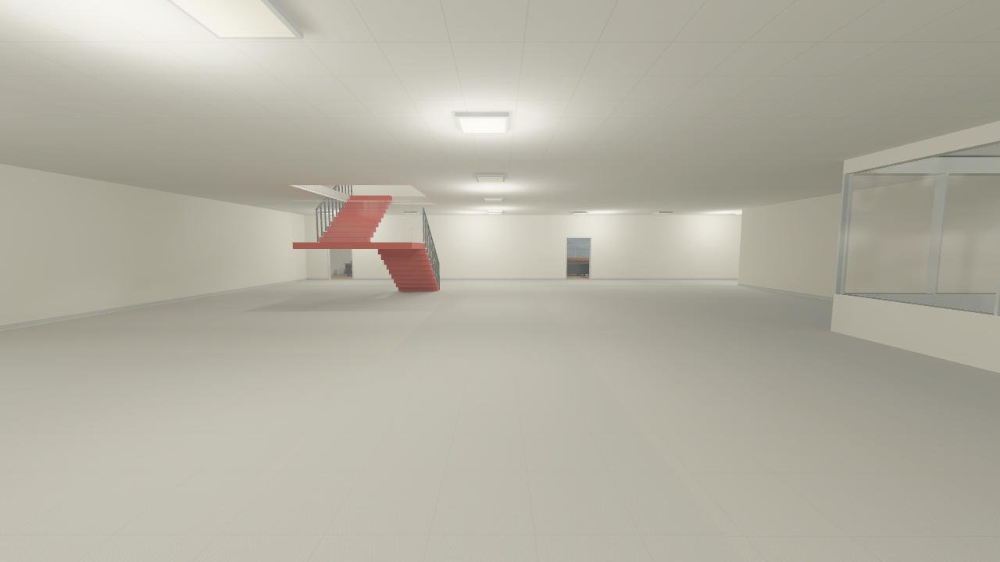
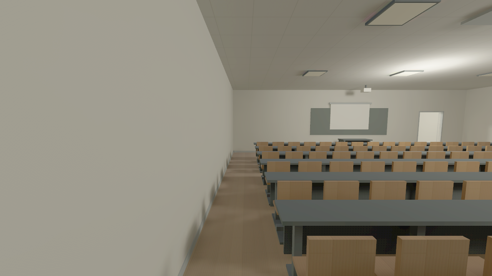
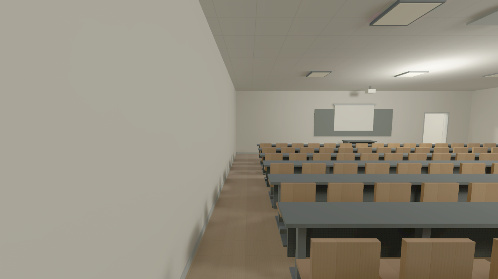

# Povo campus visual review — 23 October 2026

The subsequent [complete room/four-stair revision](POVO_ROOMS_STAIRS_REVIEW.md)
supersedes the package below. It adds all-room furnishing, lighter off-white
circulation floors, normal north corridors and four enclosed mirrored stairs.
The comparisons here describe the earlier exposure/material correction.

The earlier campus checkpoint passed compilation and traversal checks without a
reliable visual review. The user's in-game review rejected its appearance. A
foreground CS2 inspection confirmed severe overexposure, mottled baked lighting,
bare door openings, a largely featureless ceiling and oversized solid red stair
supports. Compilation success did not establish acceptable appearance.

## Corrections

- Campus materials now have explicit original albedo, neutral normal and
  roughness maps, with grey aggregate floors, acoustic ceiling panels and wood.
- The campus exposure range is 0.08–0.22 instead of a fixed 1.0. Its exposure
  volume is the master so the campus settings also apply to diagnostic cameras.
- The occupied model explicitly uses lightmaps. The density guide is resized
  around the two occupied floors instead of inheriting the enormous exposure
  shell's scale. The map compile uses `-lightmapVRadQuality 1` rather than the
  default quick bake.
- Door frames, wall skirtings and corridor ceiling fixtures add architectural
  detail without changing the accepted room footprints or door clearances.
- Stair treads and the intermediate landing are 18 cm thick rather than full
  red columns. Collision uses those same thin structural surfaces. Tread tops,
  riser heights, landing and flight locations are retained; visible outer
  handrails follow the stair slope.

Reference comparison used walk contact sheet 3, especially photos 40 (corridor),
39 (red stair), 38 (stair landing) and 37–35 (entrance), plus the classroom photos.
Finishes and trim remain approximate; no photograph pixels are used as textures.

## Review evidence

The comparison camera uses Source position `(2755.906, 551.181, 158)` and angles
`(5, 0, 0)` at standing height on the ground floor. Images are actual engine
screenshots converted from TGA to PNG, without retouching. Foreground window
captures were also inspected directly.

Before:

The first correction pass, before the higher-quality lighting bake:

Final correction pass, including the higher-quality bake and reflection capture:

The classroom cameras are `(2150, 334, 300) / (5, 90, 0)` for A215 and
`(3900, 492, 158) / (5, 180, 0)` for A103. Diagnostic camera placement uses noclip;
the separate stair traversal uses normal standing movement with noclip off.

## Verified corrected package

- Model, map and all four radar textures compile with zero resource failures;
  the existing duplicate-bone warning remains. Map compilation took about
  12 minutes 40 seconds, including a 10 minute 38 second lighting bake.
- The density-distance warning fell from 99% of triangles to 23%, largely the
  retained exterior backdrop. The map retains 2,168 navigation areas.
- All 90 source tests and both floor audits pass (18 ground / 49 upper stations).
- Normal forward movement traversed both flights up and down with turns on the
  landing, without jumping, crouching or noclip. Recorded foot heights were
  157.5 → 228.4 → 299.7 → 228.4 → 158.0 Source units. Exact results are in
  `build/gameplay/visual-stair-check.json` and its matching log.
- `buildcubemaps` added the reflection array. Every pre-existing package entry
  was compared with its staged SHA256 and remained unchanged. The final 138
  entries all pass CRC checks. This does not establish a full objective round.
- Final package: `build/package/trento_povo_campus.vpk`, **32,390,610 bytes**,
  SHA256 `941ae271dff76063407438475400e2d68f2582a6d3ec80030826e9ec49bcf8aa`.
  The isolated test addon and `play_campus.cmd` use this same package.

Build logs are `build/gameplay/campus-visual-final-build.log`,
`campus-visual-final-runtime.log` and `campus-visual-final-cubemaps.log`.
Rebuilding the map replaces the lighting package; repeat the in-game reflection
bake before distributing a fresh build. The local adoption script
`build/gameplay/adopt-baked-package.py` checks that only the cubemap entry was
added and preserves the unbaked package alongside the final one.

## Remaining appearance work

This remains a coarse campus prototype. The empty ground-floor public spaces,
reception, room-by-room light levels (A103 is still too dim), external stair context,
detailed glazing, believable furniture shapes,
exterior terrain/facades and room-specific decoration need further reconstruction.
Representative screenshots do not constitute approval of every room or a claim
of a finished map. Floor-2/bridge/Povo-2 scope and gameplay acceptance checks stay
as documented in the campus route and playtest guides.

The original installed editable content and campus package were preserved in
`build/visual-backup-20261023-183253/`. Build/runtime evidence stays locally under
`build/gameplay/`; the versioned screenshots preserve the visible findings.
