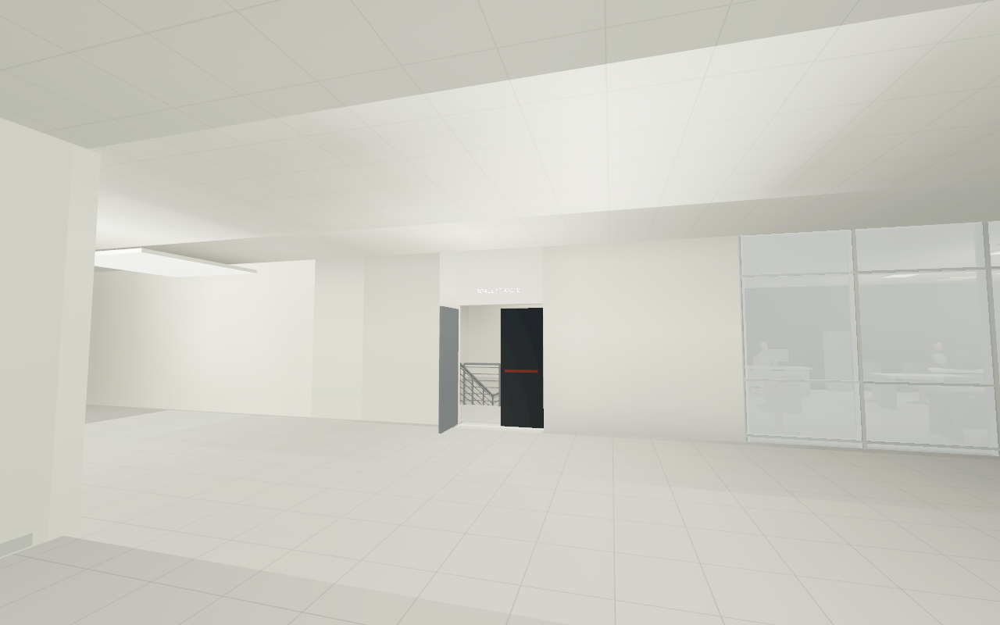
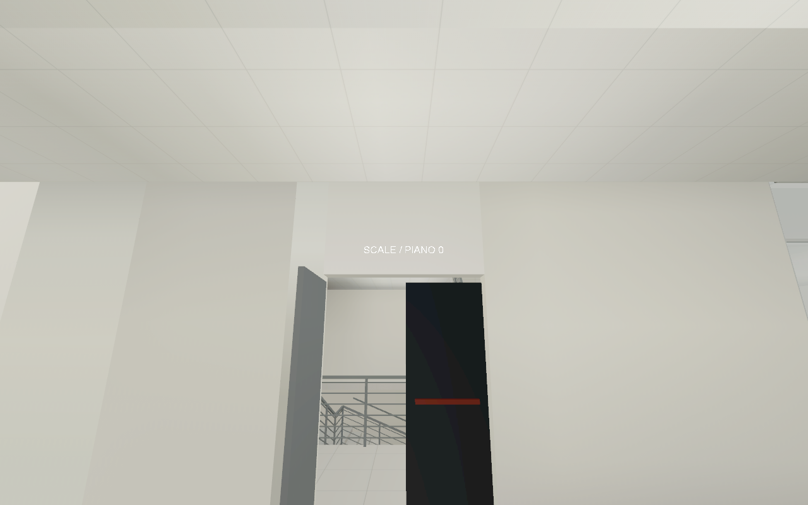
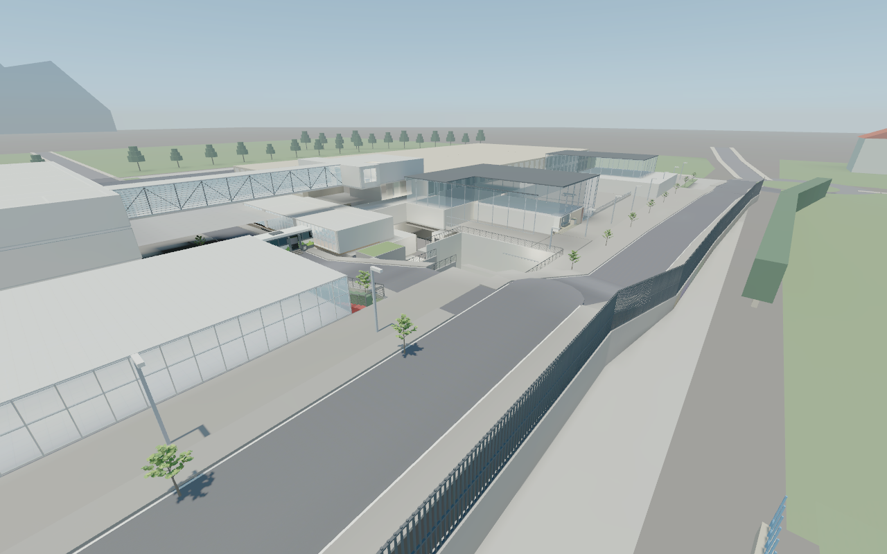

# Povo 2 entrance and exterior concrete — 2 November 2026

Completed the interrupted entrance and A–D exterior-fill revision and promoted
the exact reviewed candidate to the standard local launcher package.

- Removed nine obsolete wall-top pieces hanging below the entrance ceiling.
  The widened approach now has continuous flat ceiling finish.
- Replaced the overlapping stair labels with one **SCALE / PIANO 0** sign.
- Closed the unused side bay left of the stair doorway. The actual doorway,
  approach corridor and classroom junction remain open.
- Applied the [A–D drawing](exterior_fill_proposal.png): concrete facing around
  A, upper edge closures B/C, and closed supports D below the existing paving.
  The lower approach, both outdoor stairs and garden remain accessible.

The [source comparison](source-preservation.json) confirms identical approved
Povo 2 basement metadata, unchanged existing exterior meshes and unchanged
asphalt collision. It records all removed/added boxes. This review covers the
specified A–D areas; it does not certify every exterior gap across the campus.

## Verification

- **378 source tests pass.**
- Campus render model: **660,907 faces, zero coplanar overlaps**. Paving:
  **7,087 faces, zero coplanar overlaps**.
- Native shared model: **49m20s, zero failures**. Map: **911 compiled,
  zero failures, 13m22s**. Normal-quality GPU lighting used a 1024-pixel atlas;
  no lighting-recovery workaround was applied.
- Actual packaged PHYS: **77 entrance/fill checks pass**, including removed
  hanging walls, continuous ceiling, closed bay, retained stair portal and fills.
- Basement regression: **22,997 floor samples**, **72 column samples** and
  **36 fixed-door surface samples**, all passing.
- **10 native views** individually inspected with **mat_fullbright = 0**.
  The close B/C camera partly occludes the bottom of its frame; compiled checks
  and ordinary lower-approach walks provide the corresponding support evidence.
- **12 ordinary standing routes / 110 waypoints pass**: entrance corridor,
  stair doorway, lower approach, lower garden and both outdoor stairs, each in
  both directions. One initial placement per route; subsequent movement uses
  ordinary walking with noclip off. The retained stair door was explicitly
  opened for its route. Intermediate stair waypoints use the existing stair
  tolerance; terminal floors retain the standard 25 cm height tolerance.
- Fresh review addon contains the packaged candidate and addon metadata.
  Its package bytes match the promoted standard package. All **1,234 entry
  CRCs** pass after promotion.

## Package and limits

- Package: `build/package/trento_povo_campus.vpk`
- Size: **62,707,301 bytes**
- SHA-256: `18d154a01b9cdbe554db740657cd700899dab4ebc4ac8a5541ed4eaacafcd753`
- Previous standard package and manifest are preserved under
  `build/exterior-entrance-20261102/backup/`.

The reviewed solo game was left open at the corrected entrance. After closing
CS2, `play_campus.cmd` loads this same standard package on the next launch.
Winter, Workshop, multiplayer and a complete campus walkthrough were not
updated or tested.

The previously recorded flat asphalt joint at **(62,0,7.602)** remains in source.
The full uphill street route was not retested here and remains uncertified;
see the [earlier asphalt failure](../street_concrete_fix_20261102/README.md#remaining-asphalt-grade-issue).

## Evidence and reproduction

[Validation summary](validation-summary.json), [source tests](source-tests.log),
[source preservation](source-preservation.json), [campus surface audit](main-overlaps.json),
[paving surface audit](paving-overlaps.json), [compiled entrance/fills](compiled-checks.json),
[compiled basement](compiled-floors.json), [walking results](walking/survey-runtime.json),
[visual review](native/visual-review.json), [capture manifest](native/captures.json),
[contact sheet](native/contact-sheet.jpg), [native compile log](native-build.log),
[promoted package check](promoted-package-check.json).

From the repository root, `build_candidate.py` builds a separate candidate with
short-path packaging; `verify_source.py` checks the saved pre-change assembly;
`verify_compiled.py` reads candidate PHYS; `launch_review.ps1` loads a fresh solo
review addon; `capture_views.py` and `walk_routes.py` perform the native review.
`promote.py` requires the passing reports before replacing the local package.

The initial capture stopped at an uppercase screenshot name rejected by CS2;
its [log is retained](native/capture-first-attempt.log). Lowercase capture tokens
pass. The initial review process subsequently lost its console connection and
was restarted; the completed captures and walks use the fresh session.
No geometry was changed during resumed verification.
