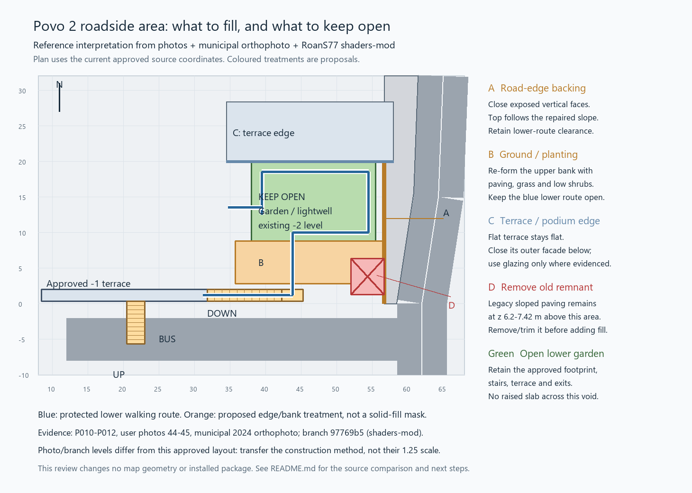

# Povo 2 road/garden fill plan

Reference review of the unfinished area beside the inclined road and bus,
including the user's photos, Google Maps, municipal orthophotography and
RoanS77's `shaders-mod` remake (`97769b5`). This is a proposal; no map geometry
or installed package was changed during the review.

[Editable SVG](fill_review_plan.svg) ·
[Full evidence and implementation handoff](../../docs/POVO2_AREA_FILL_REFERENCE_20261104.md)

The key distinction is between exposed road/terrace sides that need closing,
ground/planting that needs completing, and the real open lower garden. The
orange area is not a blanket solid-fill mask: the blue lower route stays open.

The source also confirms a leftover raised ramp above the garden edge, at
Z6.2–7.42 m. Remove/trim that remnant before designing new backing; filling
under every leftover triangle would retain its incorrect shape.

Primary local photo references:

- [P010, street/pavilions and level change](../../data/reference/povo_photos/images/P010_povo2_glass_facade_landscaping.jpg).
- [P011, paved terrace and edge/glazing](../../data/reference/povo_photos/images/P011_povo2_street_facing_facade.jpg).
- [P012, open lower space and retaining wall](../../data/reference/povo_photos/images/P012_povo2_courtyard_terrace.jpg).
- [Photo 44, lower garden/stair](../../data/reference/povo_photos/walk_2026-10-27/wetransfer_image00001-jpeg_2026-10-27_1300/image00044.jpeg).

[Source diagnostic samples](source-area-diagnostic.json) and
[final assembled bounds](approved-area-bounds.json) support the plan. Current
approved stair locations were read from the final assembled model, avoiding
the superseded early garden configuration.
