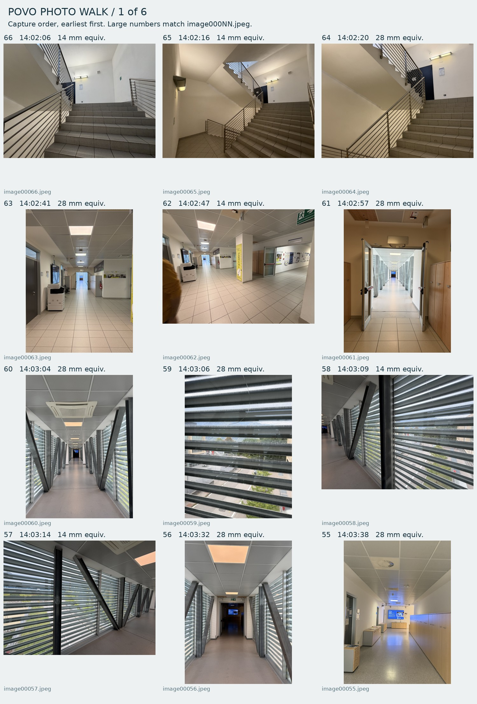
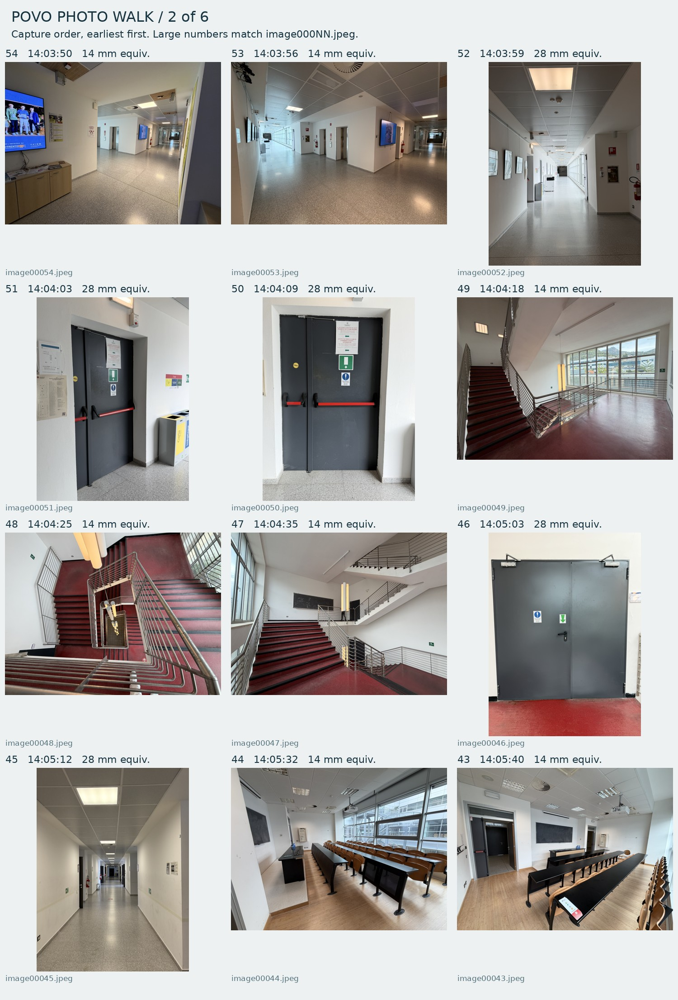
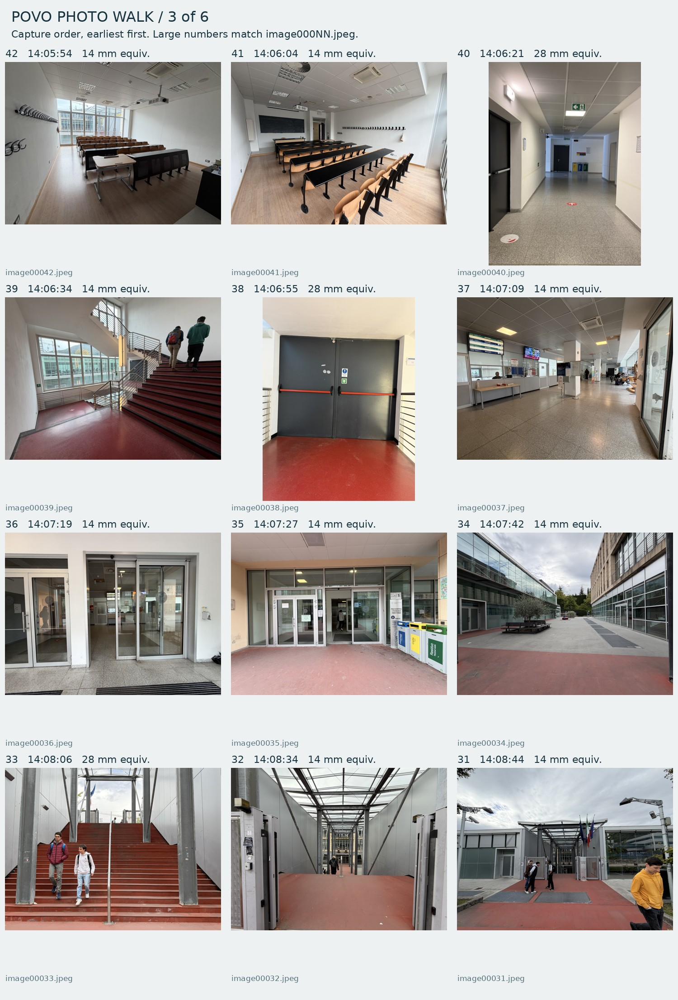
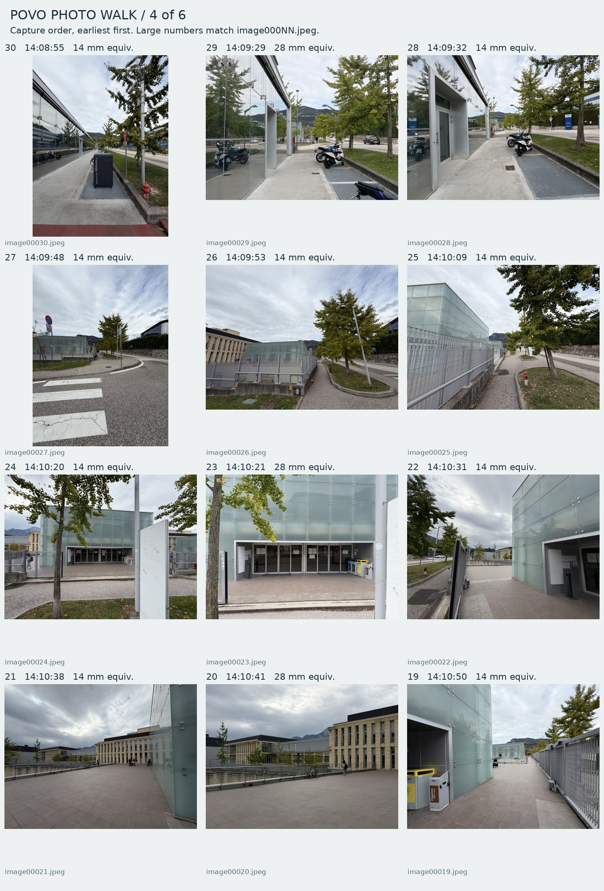
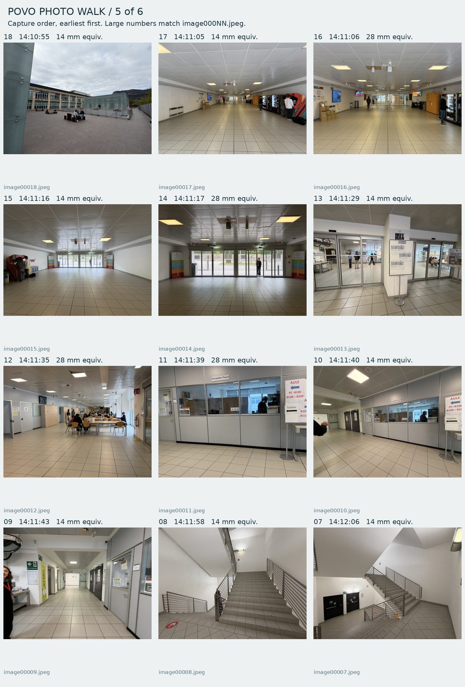
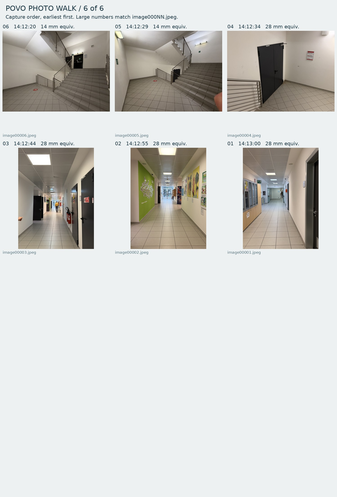

# Povo photo walk — 23 October 2026

Source: `../../data/reference/povo_photos/walk_2026-10-23/originals`. All 66 images retain camera, lens, capture time, GPS and heading metadata. Source numbering is reverse chronological: 66 first, 01 last.

Use the existing filename numbers in chat. Group photos from the same place; identify room/floor first, then direction if known. A range such as `66–60` follows the walk. You do not need to annotate each image.

Example format: `66–64: stairs in [building], from [floor] to [floor], near room [number]. 63–62: corridor toward [landmark]. 61–56: bridge, walking from [building] to [building].`

A [route worksheet](ROUTE_NOTES.md) lists visually grouped sections; identities and floor levels are left for your confirmation.

For stairs, add the nearest room and step count per flight if known. For a turn or floor change, mark the photo where it happens. Unknown directions can remain unknown; GPS and compass are not treated as an indoor survey.

## Review sheets

### Page 1

### Page 2

### Page 3

### Page 4

### Page 5

### Page 6

## Individual originals

| Photo | Capture time | Original | Location / floor / direction |
| --- | --- | --- | --- |
| 66 | 14:02:06 | [image00066.jpeg](../../data/reference/povo_photos/walk_2026-10-23/originals/image00066.jpeg) | |
| 65 | 14:02:16 | [image00065.jpeg](../../data/reference/povo_photos/walk_2026-10-23/originals/image00065.jpeg) | |
| 64 | 14:02:20 | [image00064.jpeg](../../data/reference/povo_photos/walk_2026-10-23/originals/image00064.jpeg) | |
| 63 | 14:02:41 | [image00063.jpeg](../../data/reference/povo_photos/walk_2026-10-23/originals/image00063.jpeg) | |
| 62 | 14:02:47 | [image00062.jpeg](../../data/reference/povo_photos/walk_2026-10-23/originals/image00062.jpeg) | |
| 61 | 14:02:57 | [image00061.jpeg](../../data/reference/povo_photos/walk_2026-10-23/originals/image00061.jpeg) | |
| 60 | 14:03:04 | [image00060.jpeg](../../data/reference/povo_photos/walk_2026-10-23/originals/image00060.jpeg) | |
| 59 | 14:03:06 | [image00059.jpeg](../../data/reference/povo_photos/walk_2026-10-23/originals/image00059.jpeg) | |
| 58 | 14:03:09 | [image00058.jpeg](../../data/reference/povo_photos/walk_2026-10-23/originals/image00058.jpeg) | |
| 57 | 14:03:14 | [image00057.jpeg](../../data/reference/povo_photos/walk_2026-10-23/originals/image00057.jpeg) | |
| 56 | 14:03:32 | [image00056.jpeg](../../data/reference/povo_photos/walk_2026-10-23/originals/image00056.jpeg) | |
| 55 | 14:03:38 | [image00055.jpeg](../../data/reference/povo_photos/walk_2026-10-23/originals/image00055.jpeg) | |
| 54 | 14:03:50 | [image00054.jpeg](../../data/reference/povo_photos/walk_2026-10-23/originals/image00054.jpeg) | |
| 53 | 14:03:56 | [image00053.jpeg](../../data/reference/povo_photos/walk_2026-10-23/originals/image00053.jpeg) | |
| 52 | 14:03:59 | [image00052.jpeg](../../data/reference/povo_photos/walk_2026-10-23/originals/image00052.jpeg) | |
| 51 | 14:04:03 | [image00051.jpeg](../../data/reference/povo_photos/walk_2026-10-23/originals/image00051.jpeg) | |
| 50 | 14:04:09 | [image00050.jpeg](../../data/reference/povo_photos/walk_2026-10-23/originals/image00050.jpeg) | |
| 49 | 14:04:18 | [image00049.jpeg](../../data/reference/povo_photos/walk_2026-10-23/originals/image00049.jpeg) | |
| 48 | 14:04:25 | [image00048.jpeg](../../data/reference/povo_photos/walk_2026-10-23/originals/image00048.jpeg) | |
| 47 | 14:04:35 | [image00047.jpeg](../../data/reference/povo_photos/walk_2026-10-23/originals/image00047.jpeg) | |
| 46 | 14:05:03 | [image00046.jpeg](../../data/reference/povo_photos/walk_2026-10-23/originals/image00046.jpeg) | |
| 45 | 14:05:12 | [image00045.jpeg](../../data/reference/povo_photos/walk_2026-10-23/originals/image00045.jpeg) | |
| 44 | 14:05:32 | [image00044.jpeg](../../data/reference/povo_photos/walk_2026-10-23/originals/image00044.jpeg) | |
| 43 | 14:05:40 | [image00043.jpeg](../../data/reference/povo_photos/walk_2026-10-23/originals/image00043.jpeg) | |
| 42 | 14:05:54 | [image00042.jpeg](../../data/reference/povo_photos/walk_2026-10-23/originals/image00042.jpeg) | |
| 41 | 14:06:04 | [image00041.jpeg](../../data/reference/povo_photos/walk_2026-10-23/originals/image00041.jpeg) | |
| 40 | 14:06:21 | [image00040.jpeg](../../data/reference/povo_photos/walk_2026-10-23/originals/image00040.jpeg) | |
| 39 | 14:06:34 | [image00039.jpeg](../../data/reference/povo_photos/walk_2026-10-23/originals/image00039.jpeg) | |
| 38 | 14:06:55 | [image00038.jpeg](../../data/reference/povo_photos/walk_2026-10-23/originals/image00038.jpeg) | |
| 37 | 14:07:09 | [image00037.jpeg](../../data/reference/povo_photos/walk_2026-10-23/originals/image00037.jpeg) | |
| 36 | 14:07:19 | [image00036.jpeg](../../data/reference/povo_photos/walk_2026-10-23/originals/image00036.jpeg) | |
| 35 | 14:07:27 | [image00035.jpeg](../../data/reference/povo_photos/walk_2026-10-23/originals/image00035.jpeg) | |
| 34 | 14:07:42 | [image00034.jpeg](../../data/reference/povo_photos/walk_2026-10-23/originals/image00034.jpeg) | |
| 33 | 14:08:06 | [image00033.jpeg](../../data/reference/povo_photos/walk_2026-10-23/originals/image00033.jpeg) | |
| 32 | 14:08:34 | [image00032.jpeg](../../data/reference/povo_photos/walk_2026-10-23/originals/image00032.jpeg) | |
| 31 | 14:08:44 | [image00031.jpeg](../../data/reference/povo_photos/walk_2026-10-23/originals/image00031.jpeg) | |
| 30 | 14:08:55 | [image00030.jpeg](../../data/reference/povo_photos/walk_2026-10-23/originals/image00030.jpeg) | |
| 29 | 14:09:29 | [image00029.jpeg](../../data/reference/povo_photos/walk_2026-10-23/originals/image00029.jpeg) | |
| 28 | 14:09:32 | [image00028.jpeg](../../data/reference/povo_photos/walk_2026-10-23/originals/image00028.jpeg) | |
| 27 | 14:09:48 | [image00027.jpeg](../../data/reference/povo_photos/walk_2026-10-23/originals/image00027.jpeg) | |
| 26 | 14:09:53 | [image00026.jpeg](../../data/reference/povo_photos/walk_2026-10-23/originals/image00026.jpeg) | |
| 25 | 14:10:09 | [image00025.jpeg](../../data/reference/povo_photos/walk_2026-10-23/originals/image00025.jpeg) | |
| 24 | 14:10:20 | [image00024.jpeg](../../data/reference/povo_photos/walk_2026-10-23/originals/image00024.jpeg) | |
| 23 | 14:10:21 | [image00023.jpeg](../../data/reference/povo_photos/walk_2026-10-23/originals/image00023.jpeg) | |
| 22 | 14:10:31 | [image00022.jpeg](../../data/reference/povo_photos/walk_2026-10-23/originals/image00022.jpeg) | |
| 21 | 14:10:38 | [image00021.jpeg](../../data/reference/povo_photos/walk_2026-10-23/originals/image00021.jpeg) | |
| 20 | 14:10:41 | [image00020.jpeg](../../data/reference/povo_photos/walk_2026-10-23/originals/image00020.jpeg) | |
| 19 | 14:10:50 | [image00019.jpeg](../../data/reference/povo_photos/walk_2026-10-23/originals/image00019.jpeg) | |
| 18 | 14:10:55 | [image00018.jpeg](../../data/reference/povo_photos/walk_2026-10-23/originals/image00018.jpeg) | |
| 17 | 14:11:05 | [image00017.jpeg](../../data/reference/povo_photos/walk_2026-10-23/originals/image00017.jpeg) | |
| 16 | 14:11:06 | [image00016.jpeg](../../data/reference/povo_photos/walk_2026-10-23/originals/image00016.jpeg) | |
| 15 | 14:11:16 | [image00015.jpeg](../../data/reference/povo_photos/walk_2026-10-23/originals/image00015.jpeg) | |
| 14 | 14:11:17 | [image00014.jpeg](../../data/reference/povo_photos/walk_2026-10-23/originals/image00014.jpeg) | |
| 13 | 14:11:29 | [image00013.jpeg](../../data/reference/povo_photos/walk_2026-10-23/originals/image00013.jpeg) | |
| 12 | 14:11:35 | [image00012.jpeg](../../data/reference/povo_photos/walk_2026-10-23/originals/image00012.jpeg) | |
| 11 | 14:11:39 | [image00011.jpeg](../../data/reference/povo_photos/walk_2026-10-23/originals/image00011.jpeg) | |
| 10 | 14:11:40 | [image00010.jpeg](../../data/reference/povo_photos/walk_2026-10-23/originals/image00010.jpeg) | |
| 09 | 14:11:43 | [image00009.jpeg](../../data/reference/povo_photos/walk_2026-10-23/originals/image00009.jpeg) | |
| 08 | 14:11:58 | [image00008.jpeg](../../data/reference/povo_photos/walk_2026-10-23/originals/image00008.jpeg) | |
| 07 | 14:12:06 | [image00007.jpeg](../../data/reference/povo_photos/walk_2026-10-23/originals/image00007.jpeg) | |
| 06 | 14:12:20 | [image00006.jpeg](../../data/reference/povo_photos/walk_2026-10-23/originals/image00006.jpeg) | |
| 05 | 14:12:29 | [image00005.jpeg](../../data/reference/povo_photos/walk_2026-10-23/originals/image00005.jpeg) | |
| 04 | 14:12:34 | [image00004.jpeg](../../data/reference/povo_photos/walk_2026-10-23/originals/image00004.jpeg) | |
| 03 | 14:12:44 | [image00003.jpeg](../../data/reference/povo_photos/walk_2026-10-23/originals/image00003.jpeg) | |
| 02 | 14:12:55 | [image00002.jpeg](../../data/reference/povo_photos/walk_2026-10-23/originals/image00002.jpeg) | |
| 01 | 14:13:00 | [image00001.jpeg](../../data/reference/povo_photos/walk_2026-10-23/originals/image00001.jpeg) | |
