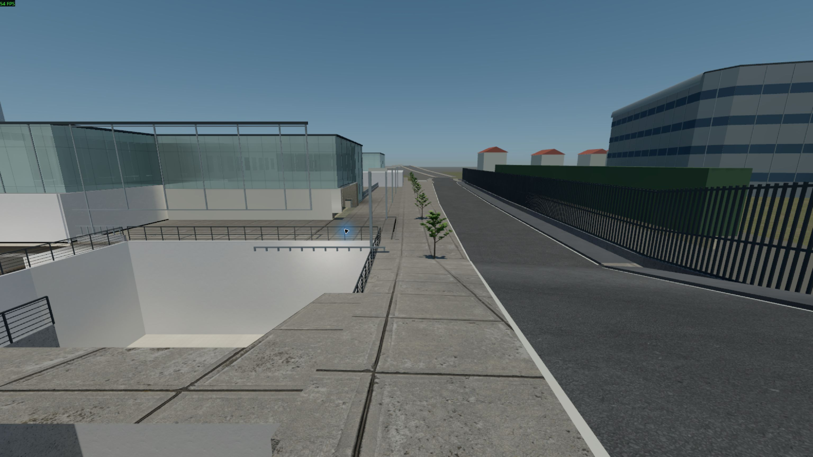
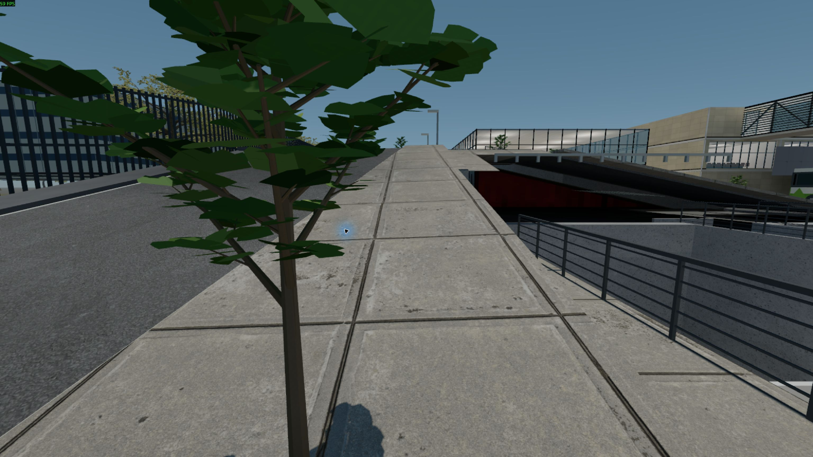
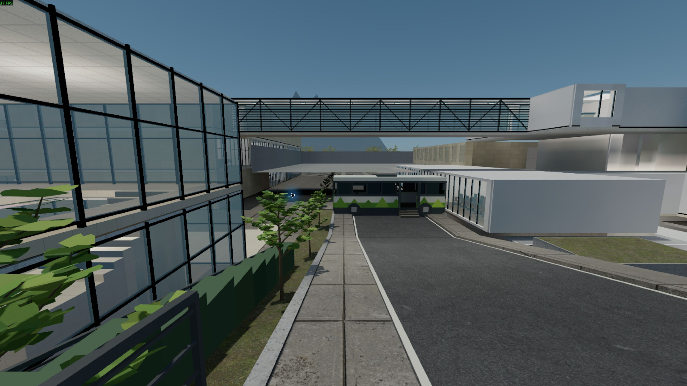
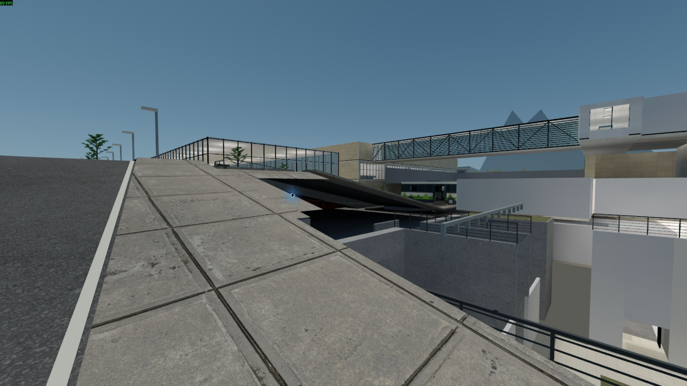

# Sloped sidewalk review — 4 November 2026

The overlapping campus-side sidewalk now follows one curb-aligned grade.
All **423 source tests**, **250 native collision samples** and **10 normal
walking routes / 50 waypoints** pass. The complete cold build took **16m26s**.

The new standard package is loaded in CS2 and installed for `play_campus.cmd`.
SHA-256: `09396dc0e1bb6709c528335a44d3c66911f63dee549f33472acbc06634a87bac`.
Its 1,205 package entry CRCs pass. Previous normal packages are backed up under
`build/sidewalk-fix-20261104/`.

## Native screenshots

These are unedited captures from CS2 with normal lighting (`mat_fullbright 0`).
Exact view positions, settings and hashes are in [captures.json](captures.json).

The [previous view](../bundle_review_20261104/povo2_current_view.png) shows the
overlapping gray strip before this repair. Existing dark surfaces farther
inside the garden/approach are still visible; this pass verifies the sidewalk
walking surface and does not claim those separate patches are repaired.

See [the complete handoff](../../docs/POVO2_SLOPED_SIDEWALK_20261104.md),
[normal walking results](exterior-runtime-walk.json),
[compiled sidewalk results](compiled-sidewalks.json),
[layout comparison](layout-comparison.json), and
[local package deployment](promotion.json).
